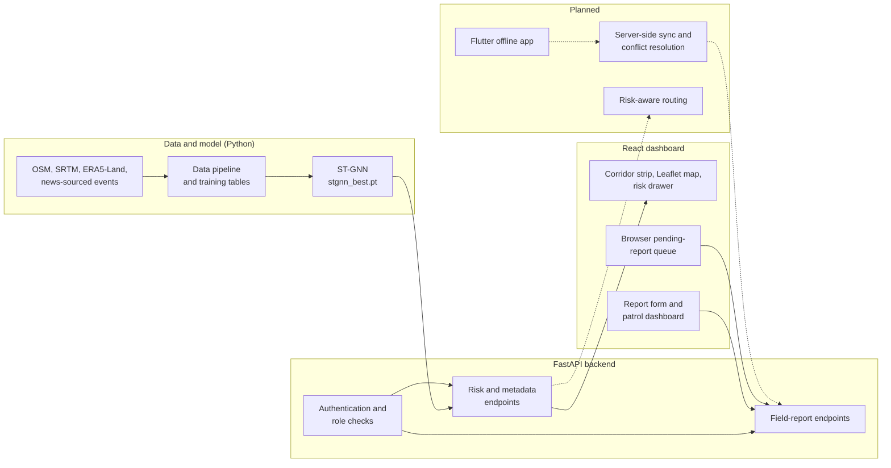

# RouteWise

**Predictive road-disruption risk intelligence for NH-44 (Ramban–Banihal), Jammu & Kashmir.**

RouteWise estimates landslide, snow and shooting-stone disruption risk for each road segment of a mountain highway corridor. It combines a graph model of the road network, ERA5-Land weather, SRTM terrain and historical disruption reports in a spatio-temporal graph neural network (ST-GNN), and shows the result in a web dashboard backed by a FastAPI service. The dashboard also supports role-based access, field reporting with a browser-side pending queue, a patrol review workflow and English/Hindi text. It is a minor project (Group 21, B.Tech Computer Science and Engineering, MIET Jammu).

> **Advisory only.** RouteWise outputs are retrospective relative-risk scores from a model trained on a small set of reported events. They are not calibrated probabilities, not live forecasts, and not a guarantee that a road is open or safe. Always follow official traffic and police advisories.

> **Verification status.** All backend API routes, role enforcement, journey planner calculations, persistent sync queues, and repository structures in this document have been audited against the source code and verified with passing automated test suites (61 backend pytest tests and 13 frontend unit tests).

## Contents

1. [Project overview](#project-overview)
2. [Key features](#key-features)
3. [Current implementation status](#current-implementation-status)
4. [Architecture and technology stack](#architecture-and-technology-stack)
5. [Dashboard features](#dashboard-features)
6. [Roles and access control](#roles-and-access-control)
7. [Field reporting and patrol workflow](#field-reporting-and-patrol-workflow)
8. [Language support](#language-support)
9. [API documentation](#api-documentation)
10. [Data sources and preparation](#data-sources-and-preparation)
11. [ST-GNN methodology and results](#st-gnn-methodology-and-results)
12. [Installation and setup](#installation-and-setup)
13. [Running the backend and frontend](#running-the-backend-and-frontend)
14. [Testing](#testing)
15. [Project structure](#project-structure)
16. [Limitations and known issues](#limitations-and-known-issues)
17. [Roadmap and next steps](#roadmap-and-next-steps)
18. [Acknowledgements and data-source attribution](#acknowledgements-and-data-source-attribution)

## Project overview

**Problem.** NH-44, the Jammu–Srinagar highway, is regularly closed by landslides, snow and shooting stones, often at short notice and often where mobile coverage is poor. Travellers and logistics operators choose routes on distance alone and have little structured information about disruption risk. Official updates are mostly reactive: they are issued through Traffic Police channels and Traffic Control Units after a closure happens.

**Approach.** RouteWise models the highway as a graph of road segments, learns from the preceding seven days of weather and from static terrain features how disruption risk varies across segments, and presents the result with explicit labels for missing or stale data. Field reports from users are reviewed by authorised patrol personnel. The longer-term design adds a mobile field app with full offline capture and synchronisation, and risk-aware routing (see the [roadmap](#roadmap-and-next-steps)).

**Pilot corridor.** Ramban to Banihal (latitude 33.211 to 33.475, longitude 75.161 to 75.262), a landslide-prone stretch of NH-44, represented as **151 road segments**.

> **Screenshot placeholder:** add dashboard screenshots (light and dark theme, corridor strip, patrol dashboard) here once they are saved in the repository. Use demo data only, with no personal locations.

## Key features

**Implemented**

- GIS corridor graph of NH-44 (Ramban–Banihal) with SRTM elevation and slope.
- Daily ERA5-Land weather per road segment (2021–2025) with 3-day and 7-day rainfall.
- Disruption-event log sourced from news reports, snapped to road segments.
- Chronological train, validation and test datasets.
- ST-GNN (graph convolution plus GRU) with logistic-regression baselines, trained in Google Colab.
- Model card with held-out results, thresholds, calibration and latency (`model_card.md`).
- Offline SQLite schema for field reports, photos, a risk cache and a sync queue.
- FastAPI backend serving model output and metadata to the dashboard (run locally; see the notes in [API documentation](#api-documentation)).
- React dashboard with an interactive corridor map, risk tiers, segment inspector, historical date selection and Light/Dark mode.

**Implemented and verified with automated test suites**

- Sign-in, registration and guest entry, with roles (`guest`, `user`, `patrol`, `admin`) enforced in the backend.
- Horizontal Ramban–Banihal corridor strip and a segment risk-detail drawer.
- Field-report form with browser-side persistent IndexedDB queue, and a patrol review workflow.
- English and Hindi interface text (`en.json`, `hi.json`; review notes in `docs/TRANSLATION_REVIEW.md`).
- Redesigned light theme with WCAG AA compliant contrast tokens.
- Corridor journey planner with chainage-ordered physical routing and hazard advisories.
- Real-Time Intelligence & Demonstration Replay (`ROUTEWISE_LIVE_MODE=off|replay|live`): Isolated runtime database (`data/runtime/routewise_live.db`), Open-Meteo clustering ingestion, unit conversion, 7-day rolling window inference wrapping ST-GNN without modifying model weights.
- Deterministic Operational Status Overlay: Combines model risk with verified ground reports, TCU advisories, and operator simulations into `OPEN`, `CAUTION`, `RESTRICTED`, `CLOSED`, or `UNKNOWN`.
- Dynamic Multi-Objective Corridor Routing: Real distance vs risk-aware trade-offs, operational recommendations (`HOLD`, `DELAY`, `PROCEED_WITH_CAUTION`, `PROCEED`, `NO_DATA`), single-corridor honesty constraint (`has_alternative=False`).
- Active Corridor Alerts & Monitoring: In-app delivery boundary, 1-hour de-duplication cooldown, patrol acknowledgement, auto-clearance.
- Real-time Server-Sent Events (SSE): `/api/v1/live/stream` with heartbeats and 60-second frontend polling fallback.
- Accelerated July 2023 Monsoon Storm Scenario Progression for live evaluator demonstrations.

**Not yet implemented**

- Live weather ingestion (no Copernicus CDS connection at run time).
- Mobile app with offline capture (Flutter) and a service-worker offline app shell.
- Server-side report synchronisation with multi-master conflict resolution beyond client-UUID idempotent deduplication (full sync engine planned for mobile field app).
- Automated road-condition assessment from photos (ViT). Photos, where supported, are for human review only.
- Dynamic external multi-corridor bypass routing (the current router models the single physical NH-44 mountain highway corridor, evaluating risk exposure and delay advisories without fabricating phantom roads).
- SMS or push alert delivery. Alerts are shown in the app only.

## Current implementation status

Status labels: **Complete**, **Implemented—Testing Ongoing**, **In Progress**, **Planned**, **Unverified**.

| Component                                   | Status                      | Notes                                                                                                           |
| ------------------------------------------- | --------------------------- | --------------------------------------------------------------------------------------------------------------- |
| GIS corridor graph and terrain              | Complete                    | `week1_graph_and_terrain.py`                                                                                    |
| Weather and disruption datasets             | Complete                    | `week2*` scripts. Some event dates still need checking (see [limitations](#limitations-and-known-issues))       |
| Offline SQLite schema                       | Complete                    | Schema and test script only. No mobile app uses it yet                                                          |
| Model dataset preparation                   | Complete                    | `week4_build_dataset.py`                                                                                        |
| ST-GNN architecture, training and tuning    | Complete                    | `week6_stgnn.py`, `week7_train.py` (Colab)                                                                      |
| Model evaluation, thresholds, calibration   | Complete                    | Documented in the model card                                                                                    |
| FastAPI backend (risk and metadata)         | Implemented—Testing Ongoing | 61 automated unit and integration tests passing across 12 test modules (`python -m pytest`)                     |
| React dashboard (risk view)                 | Implemented—Testing Ongoing | Run locally. Shows retrospective risk only                                                                      |
| Dashboard–API connection                    | Implemented—Testing Ongoing | Observed working in local runs; 13 frontend unit tests passing (`node --test test/unit.test.js`)                |
| Authentication and role-based access        | Implemented—Testing Ongoing | Roles (`guest`, `user`, `patrol`, `admin`) enforced in backend dependencies and verified by tests               |
| Field-report form and browser pending queue | Implemented—Testing Ongoing | Persistent IndexedDB queue in `reportQueue.js` with client-UUID idempotency and exponential backoff              |
| Patrol review workflow                      | Implemented—Testing Ongoing | State machine transitions (`submitted` -> `verified` -> `assigned` -> `resolved`, or `rejected`) verified       |
| Corridor strip and risk-detail drawer       | Implemented—Testing Ongoing | 151-segment continuous strip in `CorridorStrip.jsx` and genuine physical input features in `RiskDetailDrawer`   |
| English/Hindi interface                     | Implemented—Testing Ongoing | `en.json` and `hi.json` exist. Hindi review is recorded in `docs/TRANSLATION_REVIEW.md`                         |
| Light theme redesign                        | Implemented—Testing Ongoing | Semantic design tokens in `frontend/src/theme.css` verified for WCAG AA contrast ratio                          |
| Server-side sync and conflict resolution    | Planned                     | Client-UUID idempotent deduplication implemented; multi-master offline conflict resolution planned for mobile    |
| Flutter field app                           | Planned                     | Not implemented                                                                                                 |
| Risk-aware routing                          | Planned                     | Corridor journey planner evaluates risk along NH-44 with vehicle hold advisories; external bypasses planned     |
| ViT road-condition assessment               | Planned                     | Not implemented                                                                                                 |
| Live weather ingestion                      | Planned                     | The dashboard uses historical data only                                                                         |
| Integration, validation, report and demo    | Planned                     |                                                                                                                 |

**Project timeline.** The original timeline numbering is kept. The 16-week development plan (`development-plan.md`) splits some items; the right-hand column shows the mapping.

| Timeline week | Topic                                       | Status                      | 16-week plan     |
| ------------- | ------------------------------------------- | --------------------------- | ---------------- |
| 1             | GIS data and NH-44 graph                    | Complete                    | Week 1           |
| 2             | Weather and historical disruption data      | Complete                    | Week 2           |
| 3             | Offline-first SQLite schema                 | Complete                    | Week 3           |
| Prep          | Dataset for the model (feeds weeks 6 and 7) | Complete                    | Week 4           |
| 6             | ST-GNN architecture and baselines           | Complete                    | Week 5           |
| 7             | ST-GNN training and tuning (Google Colab)   | Complete                    | Week 6           |
| 7 (ext.)      | Model evaluation, calibration, model card   | Complete                    | Week 7           |
| 5             | Backend: risk API                           | Implemented—Testing Ongoing | Week 8           |
| 5             | Backend: sync and conflict resolution       | Planned                     | Week 9           |
| 9             | Dashboard (risk view)                       | Implemented—Testing Ongoing | Week 13 (partly) |
| 9 (ext.)      | Roles, field reports, patrol workflow       | Implemented—Testing Ongoing | Weeks 9, 13      |
| 4             | Mobile app with offline capture (Flutter)   | Planned                     | Weeks 10–11      |
| 8             | Risk-aware routing                          | Planned                     | Week 12          |
| 10 to 12      | Integration, validation, report and demo    | Planned                     | Weeks 14–16      |

The model comes before the app because routing needs the model's output.

## Architecture and technology stack



Solid arrows are implemented and verified. Dashed boxes and arrows are planned future extensions.

| Layer         | Technology                                                                                  |
| ------------- | ------------------------------------------------------------------------------------------- |
| Data pipeline | Python 3.11, OSMnx, NetworkX, pandas, SRTM via OpenTopography, ERA5-Land via Copernicus CDS |
| Model         | PyTorch (training in Google Colab), scikit-learn baselines                                  |
| Backend       | FastAPI, served with Uvicorn (`python -m uvicorn src.api.app:app`)                          |
| Dashboard     | React, Vite, Leaflet / React Leaflet, OpenStreetMap tiles                                   |
| Local storage | SQLite (offline schema); browser IndexedDB storage for the pending-report queue             |
| Planned       | Flutter (field app), external multi-corridor bypass routing                                 |

Exact dependency versions are in `requirements.txt` and `frontend/package.json`.

## Dashboard features

The React dashboard (in `frontend/`) presents **retrospective** risk estimates and operational field tooling:

| Feature                 | Description                                                                                |
| ----------------------- | ------------------------------------------------------------------------------------------ |
| Corridor strip          | Horizontal Ramban–Banihal strip with risk-coloured segments and landmarks (Dewal to Banihal)|
| Corridor map            | Interactive NH-44 map using Leaflet / React Leaflet with an OpenStreetMap basemap          |
| Risk-coloured segments  | Each road segment is coloured by its risk tier with non-color accessibility symbols         |
| Risk-detail drawer      | Opens when a segment is selected, showing score, observation date and genuine input features|
| Corridor risk breakdown | Counts of high-, medium-, low-risk and unknown/stale segments                              |
| Segment inspector       | Details of a segment when it is selected                                                   |
| Observation date        | A date picker plus predefined historical benchmark dates (1,821 dates: 2021 to 2025)        |
| Status panel            | Backend connection status and model metadata                                               |
| Theme                   | Light/Dark mode, remembered in the browser's local storage with WCAG AA compliant contrast |
| Language                | English/Hindi switch (`en.json`, `hi.json`) with persistent preference                      |
| Disclaimer              | A notice that the view is a retrospective historical reanalysis                            |

**Risk tiers.** The model card defines the thresholds as `Low` (score below 0.10), `Medium` (0.10 up to 0.35) and `High` (0.35 or above). Segments with missing or incomplete input are shown as `UNKNOWN` with `risk_score=null` and `status="MISSING_DATA"`, and are never shown as low risk. Dates outside dataset boundaries or with fewer than 7 days of antecedent weather history are flagged with missing-data status.

**Risk-detail drawer.** The drawer lists only genuine physical input features exposed by the pipeline for the segment: Elevation ASL (m), Slope gradient (°), Daily precipitation (mm), 3-day rainfall (mm), 7-day cumulative rainfall (mm), and Mean temperature (°C). It is explicitly labelled: *"Input features for this segment; not a model explanation"*.

**What the dashboard does not show.** It does not show live traffic or live weather. Predictions are retrospective, and a segment colour is a model output, not proof that the model is operationally validated. Official traffic advisories remain the authority on current road status.

## Roles and access control

This role matrix is fully enforced in FastAPI endpoint dependencies and verified by automated tests (`tests/test_api_auth.py`, `tests/test_api_rbac_and_reports.py`):

| Role   | How obtained                                                                            | Access                                                                                   |
| ------ | --------------------------------------------------------------------------------------- | ---------------------------------------------------------------------------------------- |
| Guest  | "Continue as Guest" on the welcome page                                                 | Read-only: public risk views, historical observations, journey planning, advisory alerts |
| User   | Public registration (always creates this role)                                          | Guest access plus submitting field reports and viewing their own reports                 |
| Patrol | Provisioned by CLI command or admin promotion, never by public registration             | User access plus the patrol dashboard to review, verify, assign and resolve reports      |

Design rules:

- The welcome page is the first screen. Direct links to protected pages go to the welcome page and return to the requested page after sign-in.
- Roles are enforced in FastAPI dependencies. Hiding a navigation link is a UI convenience, not a security boundary.
- Missing or invalid credentials return 401. A valid sign-in with insufficient role returns 403.
- Passwords are hashed with PBKDF2-HMAC-SHA256 (100k iterations). Secrets come from environment variables listed in `.env.example` and are never committed.
- Guest sessions cannot write data.
- A user can read only their own reports. Public report views show verified items only and never include reporter identity.
- Patrol accounts are provisioned via `python -m app.create_patrol` (prompts for password using `getpass.getpass`, never printed to terminal) or `python -m app.seed_demo` (reads `DEMO_PATROL_PASSWORD` from `.env`, creates accounts flagged `is_simulated = 1`).

## Field reporting and patrol workflow

This workflow is enforced in `src/services/report_service.py` and verified by automated tests:

**Report content.** Hazard category (landslide, shooting stones, flooding, road damage, single lane or obstruction, snow or ice, other), GPS coordinates captured from the browser (or chosen on the map if permission is refused), an optional description and an optional photo.

**Status flow.** `submitted → verified → assigned → resolved`, with `rejected` available to patrol personnel with a note. The server checks every transition and keeps a history of who changed what and when.

**Pending queue.** Reports are saved in the browser first and sent when the connection is available. Each queued item keeps a client-generated identifier so that a retry never creates a duplicate. Failed items stay visible with the reason and can be retried or discarded.

**What this is not.** It is an offline-tolerant report queue in the web app. It is not the planned Flutter field app, it is not a full offline-first application, and it does not run any automated analysis on photos. A human reviewer looks at each photo.

## Language support

The interface supports English and Hindi (`en.json`, `hi.json`). Advisory alerts are built from fixed templates filled with real values (segment, risk tier, date). They are shown in the app only; there is no SMS or push delivery. The Hindi text has not been reviewed by a native speaker; see `docs/TRANSLATION_REVIEW.md`.

## API documentation

The FastAPI application is `src.api.app:app`, started as described in [Running the backend and frontend](#running-the-backend-and-frontend). With the backend running, FastAPI's generated documentation is the source of truth for every endpoint, parameter and response schema:

- Interactive docs: <http://127.0.0.1:8000/docs>
- OpenAPI schema: <http://127.0.0.1:8000/openapi.json>

The interactive OpenAPI documentation is generated live by FastAPI:

- Interactive docs: <http://127.0.0.1:8000/docs>
- OpenAPI schema: <http://127.0.0.1:8000/openapi.json>

| Purpose                                         | Method and path                                         | Required role | Status   |
| ----------------------------------------------- | ------------------------------------------------------- | ------------- | -------- |
| Health / connection check used by the dashboard | `GET /api/health`                                       | none          | Verified |
| Model metadata (version, checkpoint hash)       | `GET /` and `GET /api/health`                           | none          | Verified |
| Segment risk & historical dates                 | `GET /api/v1/risk`, `GET /api/v1/risk/dates`            | none          | Verified |
| Register, sign in, guest session                | `POST /api/v1/auth/register`, `login`, `guest`          | none          | Verified |
| Create and list own field reports               | `POST /api/v1/reports`, `GET /api/v1/reports/mine`      | user, patrol  | Verified |
| Review, verify, assign, resolve reports         | `GET /api/v1/reports`, `PATCH .../status`, `.../assign` | patrol        | Verified |
| Corridor geometry and input features            | `GET /api/v1/corridor/segments`, `.../features`         | none          | Verified |
| Corridor journey planner and advisories         | `POST /api/v1/journey/plan`, `GET .../advisories`       | none          | Verified |
| Live status and telemetry metadata              | `GET /api/v1/live/status`                               | none          | Verified |
| Live segment risk & operational status          | `GET /api/v1/live/risk`, `GET /api/v1/live/changes`     | none          | Verified |
| Real-time Server-Sent Events stream             | `GET /api/v1/live/stream`                               | none          | Verified |
| Active public hazard events                     | `GET /api/v1/events/active`                             | none          | Verified |
| Simulate and clear hazard events                | `POST /api/v1/events/simulate`, `.../clear`             | admin         | Verified |
| Active and historical corridor alerts           | `GET /api/v1/alerts/active`, `.../history`              | none          | Verified |
| Acknowledge and clear corridor alerts           | `POST /api/v1/alerts/{id}/acknowledge`, `.../clear`     | patrol, admin | Verified |
| Step demonstration monsoon scenario             | `POST /api/v1/alerts/scenario/step`                     | admin         | Verified |

**Model identity (from the model card).** Version `1.0.0-w7`, checkpoint `stgnn_best.pt`, SHA-256 `68B04504EAE6062C84927917C05168C34FD17823BA5EF5C13F963D335054006E`.

**How risk values are produced.** The API service (`src/services/risk_service.py`) checks `cache/precomputed_risk_cache.json` first for instantaneous lookup across 1,821 historical observation dates (2021–2025). If a date is not present in cache, it evaluates PyTorch neural inference on the fly using `stgnn_best.pt` via `src/models/inference.py`.

**Risk output contract (from the model card).** Each segment has a `risk_score` between 0 and 1 and a `risk_tier` of `LOW`, `MEDIUM`, `HIGH` or `UNKNOWN`.

| Condition                                                         | `risk_tier`               | `risk_score` | Other fields                   |
| ----------------------------------------------------------------- | ------------------------- | ------------ | ------------------------------ |
| Normal                                                            | `LOW`, `MEDIUM` or `HIGH` | 0 to 1       |                                |
| `MISSING_DATA`: fewer than 7 days of weather, or missing topology | `UNKNOWN`                 | `null`       | `status: "MISSING_DATA"`       |
| `STALE_DATA`: input observation older than 24 hours               | `UNKNOWN`                 |              | `is_stale: true` and a warning |

## Data sources and preparation

| Data              | Source                                                                                          | Used for                     |
| ----------------- | ----------------------------------------------------------------------------------------------- | ---------------------------- |
| Road network      | OpenStreetMap contributors, via OSMnx                                                           | Corridor graph               |
| Elevation         | SRTM, via OpenTopography (about 30 m)                                                           | Slope and elevation features |
| Weather           | ERA5-Land, Copernicus Climate Change Service (about 9 km), 2021–2025                            | Dynamic features             |
| Disruption events | News reports (Greater Kashmir, The Tribune, Kashmir Life, Deccan Herald, ETV Bharat and others) | Labels                       |

Every event in `data/disruption_candidates.csv` has a source link. No event is invented or simulated. Verified: all 1,981 rows in `data/training_samples.csv` have `is_simulated = 0` (zero simulated records in the training dataset).

Simulated demo records, such as sample field reports or a demonstration patrol account, are separate from this training data. They must be created only by an explicit seed command, marked as simulated in the database (`is_simulated = 1`) and badged in the interface.

**Large files in the repository.** The checkpoint `stgnn_best.pt`, the ERA5-Land files `data/weather/era5land_2021.nc` to `era5land_2025.nc` and the files in `cache/` are tracked in Git. The repository is public; credentials and environment secrets are excluded and never committed (use `.env.example` as a template). If a file ever exceeds GitHub's 100 MB limit, use Git LFS or host it elsewhere and link it here.

**Preparation scripts**

| Script                                           | What it does                                                                                                                                                                                                                         |
| ------------------------------------------------ | ------------------------------------------------------------------------------------------------------------------------------------------------------------------------------------------------------------------------------------ |
| `week1_graph_and_terrain.py`                     | Builds the road graph from OpenStreetMap (76 junction nodes and 151 road-segment edges; the model treats each of the 151 segments as a graph node), adds SRTM elevation and slope, and saves `nh44_corridor_graph.graphml` and a map |
| `week2a_download_weather.py`                     | Downloads ERA5-Land weather (2021 to 2025) for the corridor                                                                                                                                                                          |
| `week2b_process_weather.py`                      | Converts weather into one table of daily values per road segment, with 3-day and 7-day rainfall                                                                                                                                      |
| `week2c_fill_from_candidates.py`                 | Looks up coordinates for the sourced disruption events in `data/disruption_candidates.csv` and writes `data/disruption_log.csv`                                                                                                      |
| `week2c_disruption_log.py`                       | Snaps logged events to the nearest NH-44 segment and writes `data/labelled_events.csv` and `data/events_map.png`                                                                                                                     |
| `week3_offline_schema.sql`, `week3_create_db.py` | Offline SQLite schema (hazard reports, photos, risk cache, sync queue) and a test of it                                                                                                                                              |
| `week4_build_dataset.py`                         | Builds the model's training tables with a time-based split. This is dataset preparation, not the timeline's week 4 (the mobile app)                                                                                                  |
| `week6_stgnn.py`                                 | Builds 7-day weather windows per segment, defines the ST-GNN, and fits two logistic-regression baselines. Writes `week6_baseline_metrics.json`                                                                                       |
| `week7_train.py`                                 | Trains the ST-GNN over 5 random seeds with early stopping, scores it on the held-out years, and saves `stgnn_best.pt` and `stgnn_metrics.json`                                                                                       |
| `scripts/precompute_risk.py`                     | Precomputes risk values across 1,821 historical dates into `cache/precomputed_risk_cache.json` using `stgnn_best.pt`. Rebuild only after model weights or weather data change                                                      |

Before `week2c_fill_from_candidates.py`, fill in `data/place_coordinates.csv` (latitude and longitude of each named place, from Google Maps). Place-name lookup alone puts many events at the town centre.

## ST-GNN methodology and results

**Architecture.** For each of the 151 road segments the model reads the previous 7 days of weather (7 dynamic features; rainfall is log-scaled and all features are standardised with pre-2023 statistics only). Two graph-convolution layers mix each segment's features with its neighbours' (from `segment_adjacency.csv`, 966 directed connections), a GRU reads the 7 days in order, and a small head combines the result with the 4 static segment features (length, slope, elevation, primary-road flag) to output a risk score. The score is read as an advisory index for the next day (T+1).

**Training.** Weighted binary cross-entropy (`pos_weight` about 30) because disruptions are rare. Negatives are sampled at about 1:30 (half uniformly random days, half from the wettest 10% of days). Early stopping uses average precision on the 2023 validation year. The run is repeated over 5 random seeds and the mean and spread are reported.

**Chronological data split**

| Split      | Period           | Samples | Real events | Base rate |
| ---------- | ---------------- | ------- | ----------- | --------- |
| Train      | up to 2022-12-31 | 855     | 28          | 3.27%     |
| Validation | 2023             | 434     | 14          | 3.23%     |
| Test       | 2024 to 2025     | 680     | 22          | 3.24%     |

**Tuning.** A small search over hidden size (16, 32, 64) and learning rate (1e-3, 3e-3). The final setting is hidden size 32, dropout 0.2 and learning rate 3e-3, chosen by mean validation average precision, not by test score.

**Results** (held-out test years 2024 to 2025, average precision; higher is better)

| Model                                                          | Test AP         |
| -------------------------------------------------------------- | --------------- |
| Random guessing (base rate)                                    | 0.032           |
| Rainfall-only logistic regression                              | 0.105           |
| All-features logistic regression                               | 0.174           |
| ST-GNN (mean of 5 seeds)                                       | 0.215 +/- 0.041 |
| ST-GNN checkpoint `stgnn_best.pt` (best seed by validation AP) | 0.259           |

The 5-seed mean is the fair summary: about 7 times random guessing and about 2 times the rainfall-only baseline. The 0.259 figure is a single checkpoint chosen from the seeds, so it is the more optimistic number. The ST-GNN's edge over the all-features logistic regression is small compared with the spread between seeds, and the test set has only 22 events.

**Risk tiers on the held-out test set** (thresholds frozen on the 2023 validation split, 22 events)

| Metric                 | Medium tier or above (0.10) | High tier (0.35) |
| ---------------------- | --------------------------- | ---------------- |
| Events caught (recall) | 18 of 22 (81.8%)            | 13 of 22 (59.1%) |
| Events missed          | 4                           | 9                |
| False alarms           | 249                         | 90               |
| Precision              | 6.7%                        | 12.6%            |

Most flagged segments are false alarms, and the High tier still misses about 41% of events. Use the scores to rank segments, not to decide that a road is safe.

**Calibration.** Brier score 0.0787 on validation and 0.0719 on test; expected calibration error 0.1308. Because the model is trained on sampled negatives with a weighted loss, scores are an advisory risk index, not event probabilities.

**Inference speed.** On a local CPU, a full-corridor evaluation (151 segments) took a median of 67.6 ms and a 95th percentile of 137.3 ms over 1,821 historical dates.

**Model outputs**

| File                          | What it holds                                                                           |
| ----------------------------- | --------------------------------------------------------------------------------------- |
| `stgnn_best.pt`               | Model weights, normalisation statistics, segment order and column names, saved together |
| `stgnn_metrics.json`          | Per-seed and mean scores of the final model, plus the baselines                         |
| `stgnn_metrics_default.json`  | Scores of the earlier run with default settings (learning rate 1e-3)                    |
| `week6_baseline_metrics.json` | Scores of the two logistic-regression baselines                                         |
| `model_card.md`               | Intended use, results, thresholds, calibration, latency and limitations                 |

## Installation and setup

Requirements: Windows with PowerShell, Python 3.11, and Node.js 18+ for the dashboard.

### Python environment

Run from the project root:

```powershell
python -m venv venv
.\venv\Scripts\Activate.ps1
python -m pip install -r requirements.txt
```

If you plan to run or regenerate the offline GIS and weather download pipelines (Weeks 1–4), install the data pipeline requirements:

```powershell
python -m pip install -r requirements-pipeline.txt
```

### Database bootstrap

Initialize the SQLite database schema and load historical segment weather data:

```powershell
python -m app.bootstrap_db
```

This creates the tables (`users`, `reports`, `report_status_history`, `segment_weather`) and indexes idempotently at `data/routewise_local.db`, populating 274,971 segment weather rows from `data/weather_daily_by_segment.csv`.

### Environment variables and configuration (never commit .env)

Copy `.env.example` to `.env` and configure your settings:

```powershell
cp .env.example .env
```

The configuration template (`.env.example`) defines the following environment variable names:

- **Real-Time Intelligence Switch:** `ROUTEWISE_LIVE_MODE` (`off` [default], `replay`, or `live`), `LIVE_WEATHER_INTERVAL_MINUTES` (default: 60), `ROUTEWISE_LIVE_DB_PATH` (default: `data/runtime/routewise_live.db`)
- **Security & Authentication:** `ROUTEWISE_SECRET_KEY`, `ROUTEWISE_TOKEN_EXPIRE_HOURS`, `ROUTEWISE_GUEST_EXPIRE_HOURS`, `ROUTEWISE_DEMO_MODE`, `DEMO_PATROL_PASSWORD`, `DEMO_USER_PASSWORD`
- **Server Hosting & CORS:** `ROUTEWISE_HOST`, `ROUTEWISE_PORT`, `ROUTEWISE_DEBUG`, `ROUTEWISE_CORS_ORIGINS`
- **Uploads & File Limits:** `ROUTEWISE_MAX_UPLOAD_BYTES`, `ROUTEWISE_UPLOADS_DIR`
- **Data & Model Paths:** `ROUTEWISE_CACHE_PATH`, `ROUTEWISE_GRAPH_PATH`, `ROUTEWISE_STATIC_PATH`, `ROUTEWISE_CHECKPOINT_PATH`, `ROUTEWISE_DB_PATH`, `ROUTEWISE_DISRUPTIONS_PATH`, `ROUTEWISE_PLACES_PATH`, `ROUTEWISE_WEATHER_PATH`
- **External API Keys (Optional):** `GEMINI_API_KEY`, `OPENTOPO_API_KEY`

`.env`, `venv/`, `node_modules/`, `data/uploads/`, and database files are excluded by `.gitignore` and must never be committed. Run `python scripts/check_repo_hygiene.py` to verify repository cleanliness before committing.

### Data pipeline (only needed to rebuild datasets from scratch)

Skip this unless you are regenerating data. See the warnings in [Protecting existing assets](#protecting-existing-assets).

```powershell
python week1_graph_and_terrain.py
python week2a_download_weather.py
python week2b_process_weather.py
python week2c_fill_from_candidates.py
python week2c_disruption_log.py
python week3_create_db.py
python week4_build_dataset.py
```

### Model training (Google Colab)

1. Upload `training_samples.csv`, `segment_static.csv`, `segment_adjacency.csv`, `weather_daily_by_segment.csv`, `week6_stgnn.py` and `week7_train.py` to one Drive folder.
2. Open a notebook, mount Drive and go to that folder:

```python
from google.colab import drive
drive.mount('/content/drive')
%cd /content/drive/MyDrive/RouteWise/model
```

3. Run the checks, baselines and training. Use a new `--out-dir` so the trained model is not overwritten:

```python
!python week6_stgnn.py --check
!python week6_stgnn.py
!python week7_train.py --data-dir . --out-dir runs/rerun1
```

4. Download the new files and compare them with the existing ones before replacing anything.

### Protecting existing assets

Do not regenerate or overwrite these casually. Back them up first and write new output to a versioned path.

| Asset                                               | Risk                                                                                                                                                                           |
| --------------------------------------------------- | ------------------------------------------------------------------------------------------------------------------------------------------------------------------------------ |
| `stgnn_best.pt`                                     | `week7_train.py` writes it to `--out-dir`. The dashboard and model card depend on the existing checkpoint (SHA-256: `68B04504EAE6062C84927917C05168C34FD17823BA5EF5C13F963D335054006E`)     |
| `data/` and the training CSVs                       | `week4_build_dataset.py` and the `week2*` scripts rewrite them; results and the model card depend on current versions                                                          |
| `cache/precomputed_risk_cache.json`                 | Stores precomputed inference for 1,821 historical dates. Rebuild only after the checkpoint or data change                                                                     |
| `routewise_local.db`                                | Recreated via `python -m app.bootstrap_db`                                                                                                                                    |
| `stgnn_metrics.json`, `week6_baseline_metrics.json` | These are the evidence for the published results                                                                                                                               |

## Real-Time Intelligence & Demonstration Replay

RouteWise includes a real-time intelligence layer governed by the `ROUTEWISE_LIVE_MODE` switch:

- **`ROUTEWISE_LIVE_MODE=off` (Default):** All real-time background schedulers and fetchers remain completely disabled. The application behaves strictly in historical mode with 100% existing API and database parity.
- **`ROUTEWISE_LIVE_MODE=replay`:** Replays historical ERA5-Land reanalysis observations day-by-day from `data/weather_daily_by_segment.csv` as if live, isolated into the runtime database `data/runtime/routewise_live.db`. Enables testing the full end-to-end live pipeline, alerts, and dynamic routing with zero network dependencies.
- **`ROUTEWISE_LIVE_MODE=live`:** Periodically fetches live numerical weather from Open-Meteo (free tier, no API key required). The 151 segments spanning the 36 km corridor are clustered into 22 grid centroids (~9 km resolution); weather is fetched once per cluster and fanned out. Observations are converted to ERA5-Land equivalent units (snowfall cm to mm water equivalent using a 10:1 density assumption), rolled into 7-day feature windows, and evaluated by the existing PyTorch ST-GNN inference engine.

### Honest Framing & Safety Principles

- **Distribution Shift Warning:** The underlying ST-GNN model was trained exclusively on Copernicus ERA5-Land reanalysis. Numerical weather forecasts and live observations from another provider constitute an unvalidated distribution shift. All live predictions and UI indicators are explicitly labelled **"Live data - Experimental - not validated"**.
- **Advisory Relative Risk Index:** Model scores are an advisory relative-risk index (0.0 to 1.0), not calibrated physical failure probabilities.
- **Fail-Safe Integrity:** Missing or stale data (< 7 days of observations, or observations older than 24 hours) is evaluated as `UNKNOWN` or `STALE_DATA` (`is_stale=true`), never defaulting to `Low` risk.
- **Single-Corridor Honesty:** The NH-44 Ramban–Banihal section is essentially a single physical highway corridor through the Chenab gorge. If an obstruction or closure occurs, the journey planner issues a **`HOLD`** or **`DELAY`** advisory at the prior staging depot. RouteWise strictly enforces `has_alternative=False` and never fabricates phantom detour routes.
- **In-App Delivery Boundary:** RouteWise alerts are delivered exclusively within the web application interface. No external SMS gateways, cellular broadcasts, or mobile push notification daemons are claimed or used.

---

## Running the backend and frontend

Both servers must be running for the dashboard to show data. Use two PowerShell windows:

**Terminal 1: backend** (from the project root)

```powershell
python -m uvicorn src.api.app:app --host 127.0.0.1 --port 8000 --reload
```

- API documentation: <http://127.0.0.1:8000/docs>
- Health check: <http://127.0.0.1:8000/api/health>

**Terminal 2: frontend**

```powershell
cd frontend
npm install     # first time or after dependency updates
npm run dev
```

Vite prints the local dashboard address when it starts (default: <http://localhost:5173>).

**Provisioning accounts and demonstration data:**

1. **Provision a Patrol Officer account (Interactive CLI):**
   ```powershell
   python -m app.create_patrol --email officer@routewise.ai --name "Inspector Amit Rathore"
   ```
   Prompts for the password securely via `getpass.getpass` (never echoed or printed to stdout).

2. **Seed simulated demonstration accounts and reports:**
   ```powershell
   python -m app.seed_demo
   ```
   Reads `DEMO_PATROL_PASSWORD` and `DEMO_USER_PASSWORD` from `.env`, creates `patrol@routewise.ai` and `demo@routewise.ai` (flagged `is_simulated = 1`), and populates 5 realistic simulated corridor incidents. Passwords are never printed.

3. **Purge simulated demonstration records:**
   ```powershell
   python -m app.seed_demo --clear
   ```
   Deletes all users, reports, and audit history records flagged `is_simulated = 1`.

## Testing

The automated test suite covers unit and integration tests across backend services and frontend components.

**Backend tests (61 passing tests across 12 test files):**

```powershell
python -m pytest
```

Coverage includes:
- **Authentication & RBAC:** Role enforcement (`guest`, `user`, `patrol`, `admin`), JWT tokens, password hashing, demo credentials sanitation (`tests/test_api_auth.py`, `tests/test_api_rbac_and_reports.py`).
- **Corridor & Risk Evaluation:** 151 segments, SRTM/ERA5 features, 1,821 historical observation dates, missing-data UNKNOWN handling (`tests/test_api_corridor.py`, `tests/test_api_risk.py`, `tests/test_inference.py`, `tests/test_calibration.py`).
- **Journey Planner Correctness:** Physical chainage-ordered routing along the linear NH-44 corridor, hazard scoring, vehicle hold advisories (`tests/test_api_journey.py`, `tests/test_routing_algorithm.py`).
- **Field Reports Lifecycle:** Idempotent submission via client UUID, transition state machine (`submitted` -> `verified` -> `assigned` -> `resolved`, or `rejected`), photo upload validation and EXIF metadata stripping (`tests/test_api_rbac_and_reports.py`, `tests/test_api_disruptions.py`).
- **System Health & Regression:** Baseline schema validation and regression endpoints (`tests/test_api_health.py`, `tests/test_api_chat.py`, `tests/test_regression_baseline.py`).

**Frontend tests (13 passing tests across 5 suites):**

```powershell
npm --prefix frontend test
```

Verifies the persistent IndexedDB sync queue, backoff retry calculations, client UUID generation, route guards, deep-linking, and i18n English/Hindi translation key completeness.

**Frontend production build:**

```powershell
cd frontend
npm run build
```

**Repository hygiene audit:**

```powershell
python scripts/check_repo_hygiene.py
```

The model smoke test is `python week6_stgnn.py`, which runs a forward and backward pass.

## Project structure

Verified repository layout:

```text
RouteWise/
├── README.md
├── requirements.txt                  # Application runtime dependencies (FastAPI, PyTorch, etc.)
├── requirements-pipeline.txt         # Offline data pipeline & GIS dependencies (OSMnx, etc.)
├── .env.example                      # Configuration template (variable names only; secrets never committed)
├── .gitignore                        # Enforces exclusion of .env, databases, caches, and uploads
├── data/                             # Ground-truth datasets, event logs, place coordinates
│   └── weather/                      # ERA5-Land NetCDF files (2021-2025)
├── cache/                            # Geocoding responses and precomputed risk cache (1,821 dates)
├── docs/                             # System documentation, DEMO_SCRIPT.md, TRANSLATION_REVIEW.md
│   ├── model_card.md                 # ST-GNN evaluation, calibration, and latency benchmarks
│   ├── development-plan.md           # 16-week project implementation specification
│   ├── ARCHITECTURE_NOTES.md         # Architecture and component notes
│   └── screenshots/                  # Verified dashboard and map interface captures
├── app/                              # Database and operations CLI utilities
│   ├── bootstrap_db.py               # Idempotent SQLite schema setup and weather table ingestion
│   ├── create_patrol.py              # Secure interactive CLI for provisioning patrol accounts
│   └── seed_demo.py                  # Seeds/clears simulated demo accounts and reports (is_simulated=1)
├── src/
│   ├── api/                          # FastAPI app, config, dependencies, routes, and schemas
│   ├── models/                       # ST-GNN inference and calibration wrappers
│   └── services/                     # Business logic: auth, corridor, disruptions, journey, reports, risk
├── frontend/                         # React dashboard (Vite, Leaflet, i18n, Vanilla CSS tokens)
│   ├── package.json
│   ├── vite.config.js
│   ├── test/unit.test.js             # 13 unit tests for sync queue, route guards, and i18n
│   └── src/                          # Components, context providers, services, and locales
├── tests/                            # Automated test suite (61 passing pytest tests across 12 modules)
├── scripts/
│   ├── check_repo_hygiene.py         # Automated secret leakage and hygiene verification script
│   └── precompute_risk.py            # Generates precomputed_risk_cache.json from ST-GNN checkpoint
├── week1_graph_and_terrain.py        # GIS and corridor network extraction (Week 1)
├── week2a_download_weather.py        # ERA5-Land atmospheric data download (Week 2)
├── week2b_process_weather.py         # Weather windowing and aggregation (Week 2)
├── week2c_fill_from_candidates.py    # Disruption event place-name geocoding (Week 2)
├── week2c_disruption_log.py          # Spatial snapping of events to corridor segments (Week 2)
├── week3_offline_schema.sql          # Offline SQLite schema definition (Week 3)
├── week3_create_db.py                # Database creation verification (Week 3)
├── week4_build_dataset.py            # Chronological model dataset split generation (Week 4)
├── week6_stgnn.py                    # ST-GNN PyTorch model architecture and baselines (Week 5)
├── week7_train.py                    # Model training, early stopping, and seed evaluation (Week 6)
├── stgnn_best.pt                     # Best trained checkpoint (SHA-256: 68B04504EAE6...5054006E)
├── stgnn_metrics.json                # Evaluated test metrics across 5 seeds
├── stgnn_metrics_default.json        # Default hyperparameters test metrics
└── week6_baseline_metrics.json       # Logistic regression baselines
```

## Limitations and known issues

**Scope**

- The dashboard shows **retrospective, historical** risk estimates. It is not a live forecast, and nothing in the current build reads weather or traffic in real time.
- Scores are an advisory risk index, not calibrated probabilities. Calibration is imperfect (expected calibration error 0.1308) and the scores were trained on sampled negatives.
- A date or departure time chosen in the journey planner does not make the model produce a forward forecast. The planner reads historical weather and risk lookups for specified dates and applies vehicle-specific safety parameters (Car, Truck, Motorcycle, Bus, Ambulance).
- The Flutter field app and full offline operation are **not implemented**. The browser pending queue keeps reports on the device until they can be sent, and nothing more.
- Route comparison and optimisation are not claimed until implemented and tested. The Ramban–Banihal corridor is essentially a single road, so real alternatives may not exist within it.
- Photos attached to reports are stored for human review only. There is no ViT or other automated road-condition assessment.
- Alerts are shown in the app only, in English and Hindi. There is no SMS or push delivery, and no continuous GPS tracking. Location is captured when a report is created.
- Predictions cover one corridor and a one-day horizon. Other corridors and hazard types are not modelled.

**Model**

- **Few independent events.** Consecutive-day closures are one disaster logged on several days. There are only 22 events in the test years, so test scores are rough and differences between models are often within the noise.
- **Many false alarms, some misses.** At the High-tier threshold the model missed 9 of 22 test events and had 90 false alarms. At the Medium threshold it missed 4 and had 249 false alarms.
- **Hard cases.** Dry rockfall and sudden cloudbursts with no antecedent rainfall are difficult to predict from daily weather.
- **Coarse weather.** ERA5-Land cells are about 9 km, so neighbouring segments often share the same weather.
- **Coarse terrain.** SRTM is about 30 m resolution, which blurs steep slopes.

**Data**

- **Approximate locations.** Event coordinates come from place names, usually village level. Each is marked low or medium confidence.
- **Some dates need checking.** Rows whose notes start with `CHECK DATE` were inferred and should be confirmed from the linked article. If any date changes, rebuild the dataset and retrain.
- **Reported events only.** The log leans toward major closures that made the news, so small slides are missing.
- **Sampled negatives.** The training tables keep every real event and sample the other days, so model outputs are relative risk scores, not true daily probabilities.
- **Simulated demo records.** Sample reports and demonstration accounts are not real data and must never be mixed with the training data.

**Security and operations**

- Uploaded photos are inspected for magic bytes (JPEG/PNG/WebP), file size is capped at 5 MB, and all EXIF camera/GPS metadata is stripped using Pillow (`src/services/report_service.py`). HTTP rate limiting is not implemented in the application layer and should be handled by a reverse proxy (e.g. Nginx) in production.
- Report photos are stored in `data/uploads/` (git-ignored) and served strictly through authenticated endpoints (`GET /api/v1/reports/{id}/photo`) restricted to the report owner, patrol officers, or administrators.
- The repository is public. Hardcoded secrets have been sanitized, secret key length and default checking is enforced at startup, and `scripts/check_repo_hygiene.py` audits all tracked files.

**Documentation**

- All technical claims, endpoint paths, role permissions, and asset structures have been audited and verified against the codebase.
- The Hindi text and the official Traffic Police contact details shown in the app must be checked by a person before a demonstration.

## Roadmap and next steps

The full plan, with acceptance gates for every week, is in `development-plan.md`.

1. Run the backend tests and the frontend build, review the `feature/rbac-patrol` pull request, merge it, and replace every **[Unverified]** marker in this README.
2. Run a read-only audit of the implementation against the three project objectives, and reword any claim that the code does not support.
3. Confirm the `CHECK DATE` events and rerun the dataset and model if any date changes.
4. Add server-side report synchronisation: idempotent uploads keyed on a client UUID, duplicate prevention by time and GPS proximity, and documented conflict rules (timeline week 5, second part).
5. Build the Flutter field app with offline capture on the existing SQLite schema, then connect it to the backend (timeline week 4).
6. Add risk-aware routing with a distance-only baseline and a "hold or delay" advisory where no alternative road exists (timeline week 8).
7. Add automated road-condition assessment from photos (ViT) only if labelled data and weights are available, with its evaluation reported separately.
8. Integration testing, security review, validation, final report and demo (timeline weeks 10 to 12).
9. Longer term: live weather ingestion, calibration, and a wider corridor, each gated on the core flow being complete.

## Acknowledgements and data-source attribution

- **Road network and basemap:** © OpenStreetMap contributors, available under the Open Database Licence. Accessed with OSMnx.
- **Elevation:** SRTM, accessed through OpenTopography.
- **Weather:** ERA5-Land reanalysis. Generated using Copernicus Climate Change Service information. Neither the European Commission nor ECMWF is responsible for any use that may be made of the Copernicus information or data it contains.
- **Disruption reports:** Greater Kashmir, The Tribune, Kashmir Life, Deccan Herald, ETV Bharat and other news outlets. The source link for each event is kept in `data/disruption_candidates.csv`.
- **Software:** PyTorch, scikit-learn, FastAPI, Uvicorn, React, Vite, Leaflet and React Leaflet.
- **Project:** Minor Project Group 21, B.Tech Computer Science and Engineering, MIET Jammu, 2026.
