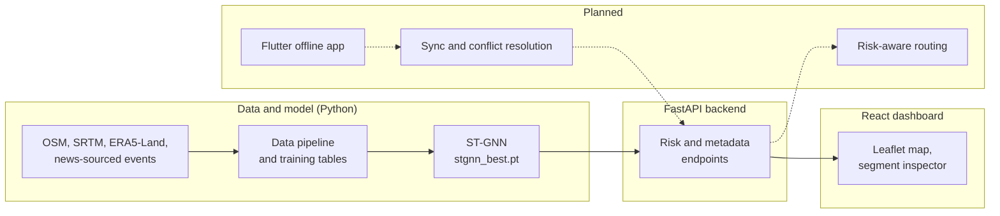

# RouteWise

**Predictive, offline-first road-disruption risk for NH-44 (Ramban–Banihal), Jammu & Kashmir.**

RouteWise estimates landslide, snow and shooting-stone disruption risk for each road segment of a mountain highway corridor. It combines a graph model of the road network, ERA5-Land weather, SRTM terrain and historical disruption reports in a spatio-temporal graph neural network (ST-GNN), and shows the result in a web dashboard backed by a FastAPI service. It is a minor project (Group 21, B.Tech Computer Science and Engineering, MIET Jammu).

> **Advisory only.** RouteWise outputs are retrospective relative-risk scores from a model trained on a small set of reported events. They are not calibrated probabilities, not live forecasts, and not a guarantee that a road is open or safe. Always follow official traffic and police advisories.

> **How to read this README.** Statements about the backend API, the test suite and the repository layout could not be checked against the source code when this README was revised. They come from the project brief and are marked **[Unverified]**. Confirm each one against the repository and remove the marker.

## Contents

1. [Project overview](#project-overview)
2. [Key features](#key-features)
3. [Current implementation status](#current-implementation-status)
4. [Architecture and technology stack](#architecture-and-technology-stack)
5. [Dashboard features](#dashboard-features)
6. [API documentation](#api-documentation)
7. [Data sources and preparation](#data-sources-and-preparation)
8. [ST-GNN methodology and results](#st-gnn-methodology-and-results)
9. [Installation and setup](#installation-and-setup)
10. [Running the backend and frontend](#running-the-backend-and-frontend)
11. [Testing](#testing)
12. [Project structure](#project-structure)
13. [Limitations and known issues](#limitations-and-known-issues)
14. [Roadmap and next steps](#roadmap-and-next-steps)
15. [Acknowledgements and data-source attribution](#acknowledgements-and-data-source-attribution)

## Project overview

**Problem.** NH-44, the Jammu–Srinagar highway, is regularly closed by landslides, snow and shooting stones, often at short notice and often where mobile coverage is poor. Travellers and logistics operators choose routes on distance alone and have little structured information about disruption risk.

**Approach.** RouteWise models the highway as a graph of road segments, learns from the preceding seven days of weather and from static terrain features how disruption risk varies across segments, and presents the result with explicit labels for missing or stale data. The longer-term design adds offline-first field reporting and risk-aware routing (see the [roadmap](#roadmap-and-next-steps)).

**Pilot corridor.** Ramban to Banihal (latitude 33.211 to 33.475, longitude 75.161 to 75.262), a landslide-prone stretch of NH-44, represented as **151 road segments**.

> **Screenshot placeholder:** add a dashboard screenshot here once one is saved in the repository. Use demo data only, with no personal locations.

## Key features

**Implemented**

- GIS corridor graph of NH-44 (Ramban–Banihal) with SRTM elevation and slope.
- Daily ERA5-Land weather per road segment (2021–2025) with 3-day and 7-day rainfall.
- Disruption-event log sourced from news reports, snapped to road segments.
- Chronological train, validation and test datasets.
- ST-GNN (graph convolution plus GRU) with logistic-regression baselines, trained in Google Colab.
- Model card with held-out results, thresholds, calibration and latency (`model_card.md`).
- Offline SQLite schema for field reports, photos, a risk cache and a sync queue.
- FastAPI backend serving model output and metadata to the dashboard (run locally; see the notes in [API documentation](#api-documentation)).
- React dashboard with an interactive corridor map, risk tiers, segment inspector, historical date selection and Light/Dark mode.

**Not yet implemented**

- Live weather ingestion (no Copernicus CDS connection at run time).
- Mobile app with offline capture (Flutter).
- Report synchronisation and conflict resolution.
- Risk-aware route optimisation.
- Field-report layer and administration view on the dashboard.

## Current implementation status

Status labels: **Complete**, **Implemented—Testing Ongoing**, **In Progress**, **Planned**, **Unverified**.

| Component                                      | Status                      | Notes                                                                                                     |
| ---------------------------------------------- | --------------------------- | --------------------------------------------------------------------------------------------------------- |
| GIS corridor graph and terrain                 | Complete                    | `week1_graph_and_terrain.py`                                                                              |
| Weather and disruption datasets                | Complete                    | `week2*` scripts. Some event dates still need checking (see [limitations](#limitations-and-known-issues)) |
| Offline SQLite schema                          | Complete                    | Schema and test script only. No mobile app uses it yet                                                    |
| Model dataset preparation                      | Complete                    | `week4_build_dataset.py`                                                                                  |
| ST-GNN architecture, training and tuning       | Complete                    | `week6_stgnn.py`, `week7_train.py` (Colab)                                                                |
| Model evaluation, thresholds, calibration      | Complete                    | Documented in the model card                                                                              |
| FastAPI backend                                | Implemented—Testing Ongoing | Run locally. Automated test coverage **[Unverified]**                                                     |
| React dashboard                                | Implemented—Testing Ongoing | Run locally. Shows retrospective risk only                                                                |
| Dashboard–API connection                       | Implemented—Testing Ongoing | Observed working in local runs                                                                            |
| Report synchronisation and conflict resolution | Planned                     | Not implemented                                                                                           |
| Flutter field app                              | Planned                     | Not implemented                                                                                           |
| Risk-aware routing                             | Planned                     | Not implemented                                                                                           |
| Live weather ingestion                         | Planned                     | The dashboard uses historical data only                                                                   |
| Integration, validation, report and demo       | Planned                     |                                                                                                           |

**Project timeline.** The original timeline numbering is kept. The 16-week development plan (`development-plan.md`) splits some items; the right-hand column shows the mapping.

| Timeline week | Topic                                       | Status                      | 16-week plan     |
| ------------- | ------------------------------------------- | --------------------------- | ---------------- |
| 1             | GIS data and NH-44 graph                    | Complete                    | Week 1           |
| 2             | Weather and historical disruption data      | Complete                    | Week 2           |
| 3             | Offline-first SQLite schema                 | Complete                    | Week 3           |
| Prep          | Dataset for the model (feeds weeks 6 and 7) | Complete                    | Week 4           |
| 6             | ST-GNN architecture and baselines           | Complete                    | Week 5           |
| 7             | ST-GNN training and tuning (Google Colab)   | Complete                    | Week 6           |
| 7 (ext.)      | Model evaluation, calibration, model card   | Complete                    | Week 7           |
| 5             | Backend: risk API                           | Implemented—Testing Ongoing | Week 8           |
| 5             | Backend: sync and conflict resolution       | Planned                     | Week 9           |
| 9             | Dashboard (risk view)                       | Implemented—Testing Ongoing | Week 13 (partly) |
| 4             | Mobile app with offline capture (Flutter)   | Planned                     | Weeks 10–11      |
| 8             | Risk-aware routing                          | Planned                     | Week 12          |
| 10 to 12      | Integration, validation, report and demo    | Planned                     | Weeks 14–16      |

The model comes before the app because routing needs the model's output.

## Architecture and technology stack



Solid arrows are implemented. Dashed boxes and arrows are planned.

| Layer         | Technology                                                                                  |
| ------------- | ------------------------------------------------------------------------------------------- |
| Data pipeline | Python 3.11, OSMnx, NetworkX, pandas, SRTM via OpenTopography, ERA5-Land via Copernicus CDS |
| Model         | PyTorch (training in Google Colab), scikit-learn baselines                                  |
| Backend       | FastAPI, served with Uvicorn                                                                |
| Dashboard     | React, Vite, Leaflet / React Leaflet, OpenStreetMap tiles                                   |
| Local storage | SQLite (offline schema)                                                                     |
| Planned       | Flutter (field app), NetworkX-based routing                                                 |

Exact dependency versions are in `requirements.txt` and `frontend/package.json`.

## Dashboard features

The React dashboard (in `frontend/`) presents **retrospective** risk estimates. These features come from the project brief; the component code was not inspected for this revision.

| Feature                 | Description                                                                       |
| ----------------------- | --------------------------------------------------------------------------------- |
| Corridor map            | Interactive NH-44 map using Leaflet / React Leaflet with an OpenStreetMap basemap |
| Risk-coloured segments  | Each road segment is coloured by its risk tier                                    |
| Corridor risk breakdown | Counts of high-, medium-, low-risk and unknown/stale segments                     |
| Segment inspector       | Details of a segment when it is selected                                          |
| Observation date        | A date picker plus predefined historical benchmark dates                          |
| Status panel            | Backend connection status and model metadata                                      |
| Theme                   | Light/Dark mode slider, remembered in the browser's local storage                 |
| Disclaimer              | A notice that the view is a retrospective historical reanalysis                   |

**Risk tiers.** The model card defines the thresholds as `Low` (score below 0.10), `Medium` (0.10 up to 0.35) and `High` (0.35 or above). Segments with missing or stale input are shown as `UNKNOWN` and are never shown as low risk. **[Unverified]** How staleness is judged when a historical observation date is selected should be confirmed in the code.

**What the dashboard does not show.** It does not show live conditions, field reports, synchronisation status or routes. A segment colour is a model output, not proof that the model is operationally validated.

## API documentation

The FastAPI application is `src.api.app:app`, started as described in [Running the backend and frontend](#running-the-backend-and-frontend). With the backend running, FastAPI's generated documentation is the source of truth for every endpoint, parameter and response schema:

- Interactive docs: <http://127.0.0.1:8000/docs>
- OpenAPI schema: <http://127.0.0.1:8000/openapi.json>

**[Unverified]** The endpoint paths, parameters and responses below have not been checked against `src/api/`. Fill in the paths from `/docs` and remove the marker. Do not add endpoints that are not in the code.

| Purpose                                         | Method and path           | Status           |
| ----------------------------------------------- | ------------------------- | ---------------- |
| Health / connection check used by the dashboard | _to confirm from `/docs`_ | **[Unverified]** |
| Model metadata (version, checkpoint hash)       | _to confirm from `/docs`_ | **[Unverified]** |
| Segment risk for an observation date            | _to confirm from `/docs`_ | **[Unverified]** |

**Model identity (from the model card).** Version `1.0.0-w7`, checkpoint `stgnn_best.pt`, SHA-256 `68B04504EAE6062C84927917C05168C34FD17823BA5EF5C13F963D335054006E`.

**Risk output contract (from the model card).** Each segment has a `risk_score` between 0 and 1 and a `risk_tier` of `LOW`, `MEDIUM`, `HIGH` or `UNKNOWN`.

| Condition                                                         | `risk_tier`               | `risk_score` | Other fields                   |
| ----------------------------------------------------------------- | ------------------------- | ------------ | ------------------------------ |
| Normal                                                            | `LOW`, `MEDIUM` or `HIGH` | 0 to 1       |                                |
| `MISSING_DATA`: fewer than 7 days of weather, or missing topology | `UNKNOWN`                 | `null`       |                                |
| `STALE_DATA`: input observation older than 24 hours               | `UNKNOWN`                 |              | `is_stale: true` and a warning |

## Data sources and preparation

| Data              | Source                                                                                          | Used for                     |
| ----------------- | ----------------------------------------------------------------------------------------------- | ---------------------------- |
| Road network      | OpenStreetMap contributors, via OSMnx                                                           | Corridor graph               |
| Elevation         | SRTM, via OpenTopography (about 30 m)                                                           | Slope and elevation features |
| Weather           | ERA5-Land, Copernicus Climate Change Service (about 9 km), 2021–2025                            | Dynamic features             |
| Disruption events | News reports (Greater Kashmir, The Tribune, Kashmir Life, Deccan Herald, ETV Bharat and others) | Labels                       |

Every event in `data/disruption_candidates.csv` has a source link. No event is invented or simulated. **[Unverified]** `training_samples.csv` contains an `is_simulated` column; confirm that every value is `0` before keeping this statement.

**Preparation scripts**

| Script                                           | What it does                                                                                                                                                                                                                         |
| ------------------------------------------------ | ------------------------------------------------------------------------------------------------------------------------------------------------------------------------------------------------------------------------------------ |
| `week1_graph_and_terrain.py`                     | Builds the road graph from OpenStreetMap (76 junction nodes and 151 road-segment edges; the model treats each of the 151 segments as a graph node), adds SRTM elevation and slope, and saves `nh44_corridor_graph.graphml` and a map |
| `week2a_download_weather.py`                     | Downloads ERA5-Land weather (2021 to 2025) for the corridor                                                                                                                                                                          |
| `week2b_process_weather.py`                      | Converts weather into one table of daily values per road segment, with 3-day and 7-day rainfall                                                                                                                                      |
| `week2c_fill_from_candidates.py`                 | Looks up coordinates for the sourced disruption events in `data/disruption_candidates.csv` and writes `data/disruption_log.csv`                                                                                                      |
| `week2c_disruption_log.py`                       | Snaps logged events to the nearest NH-44 segment and writes `data/labelled_events.csv` and `data/events_map.png`                                                                                                                     |
| `week3_offline_schema.sql`, `week3_create_db.py` | Offline SQLite schema (hazard reports, photos, risk cache, sync queue) and a test of it                                                                                                                                              |
| `week4_build_dataset.py`                         | Builds the model's training tables with a time-based split. This is dataset preparation, not the timeline's week 4 (the mobile app)                                                                                                  |
| `week6_stgnn.py`                                 | Builds 7-day weather windows per segment, defines the ST-GNN, and fits two logistic-regression baselines. Writes `week6_baseline_metrics.json`                                                                                       |
| `week7_train.py`                                 | Trains the ST-GNN over 5 random seeds with early stopping, scores it on the held-out years, and saves `stgnn_best.pt` and `stgnn_metrics.json`                                                                                       |

Before `week2c_fill_from_candidates.py`, fill in `data/place_coordinates.csv` (latitude and longitude of each named place, from Google Maps). Place-name lookup alone puts many events at the town centre.

## ST-GNN methodology and results

**Architecture.** For each of the 151 road segments the model reads the previous 7 days of weather (7 dynamic features; rainfall is log-scaled and all features are standardised with pre-2023 statistics only). Two graph-convolution layers mix each segment's features with its neighbours' (from `segment_adjacency.csv`, 966 directed connections), a GRU reads the 7 days in order, and a small head combines the result with the 4 static segment features (length, slope, elevation, primary-road flag) to output a risk score. The score is read as an advisory index for the next day (T+1).

**Training.** Weighted binary cross-entropy (`pos_weight` about 30) because disruptions are rare. Negatives are sampled at about 1:30 (half uniformly random days, half from the wettest 10% of days). Early stopping uses average precision on the 2023 validation year. The run is repeated over 5 random seeds and the mean and spread are reported.

**Chronological data split**

| Split      | Period           | Samples | Real events | Base rate |
| ---------- | ---------------- | ------- | ----------- | --------- |
| Train      | up to 2022-12-31 | 855     | 28          | 3.27%     |
| Validation | 2023             | 434     | 14          | 3.23%     |
| Test       | 2024 to 2025     | 680     | 22          | 3.24%     |

**Tuning.** A small search over hidden size (16, 32, 64) and learning rate (1e-3, 3e-3). The final setting is hidden size 32, dropout 0.2 and learning rate 3e-3, chosen by mean validation average precision, not by test score.

**Results** (held-out test years 2024 to 2025, average precision; higher is better)

| Model                                                          | Test AP         |
| -------------------------------------------------------------- | --------------- |
| Random guessing (base rate)                                    | 0.032           |
| Rainfall-only logistic regression                              | 0.105           |
| All-features logistic regression                               | 0.174           |
| ST-GNN (mean of 5 seeds)                                       | 0.215 +/- 0.041 |
| ST-GNN checkpoint `stgnn_best.pt` (best seed by validation AP) | 0.259           |

The 5-seed mean is the fair summary: about 7 times random guessing and about 2 times the rainfall-only baseline. The 0.259 figure is a single checkpoint chosen from the seeds, so it is the more optimistic number. The ST-GNN's edge over the all-features logistic regression is small compared with the spread between seeds, and the test set has only 22 events.

**Risk tiers on the held-out test set** (thresholds frozen on the 2023 validation split, 22 events)

| Metric                 | Medium tier or above (0.10) | High tier (0.35) |
| ---------------------- | --------------------------- | ---------------- |
| Events caught (recall) | 18 of 22 (81.8%)            | 13 of 22 (59.1%) |
| Events missed          | 4                           | 9                |
| False alarms           | 249                         | 90               |
| Precision              | 6.7%                        | 12.6%            |

Most flagged segments are false alarms, and the High tier still misses about 41% of events. Use the scores to rank segments, not to decide that a road is safe.

**Calibration.** Brier score 0.0787 on validation and 0.0719 on test; expected calibration error 0.1308. Because the model is trained on sampled negatives with a weighted loss, scores are an advisory risk index, not event probabilities.

**Inference speed.** On a local CPU, a full-corridor evaluation (151 segments) took a median of 67.6 ms and a 95th percentile of 137.3 ms over 1,821 historical dates.

**Model outputs**

| File                          | What it holds                                                                           |
| ----------------------------- | --------------------------------------------------------------------------------------- |
| `stgnn_best.pt`               | Model weights, normalisation statistics, segment order and column names, saved together |
| `stgnn_metrics.json`          | Per-seed and mean scores of the final model, plus the baselines                         |
| `stgnn_metrics_default.json`  | Scores of the earlier run with default settings (learning rate 1e-3)                    |
| `week6_baseline_metrics.json` | Scores of the two logistic-regression baselines                                         |
| `model_card.md`               | Intended use, results, thresholds, calibration, latency and limitations                 |

## Installation and setup

Requirements: Windows with PowerShell, Python 3.11, and Node.js for the dashboard. **[Unverified]** The required Node.js version is not stated in the project files; use the version that `frontend/package.json` expects.

### Python environment

Run from the project root:

```powershell
python -m venv venv
.\venv\Scripts\python -m pip install -r requirements.txt
```

If you prefer an activated shell, use `.\venv\Scripts\Activate.ps1`. If PowerShell blocks the script, run `Set-ExecutionPolicy -Scope Process -ExecutionPolicy Bypass` first.

PyTorch is used to train the model in Google Colab, where it is preinstalled. **[Unverified]** Whether the backend loads `stgnn_best.pt` at run time (which needs PyTorch locally) or reads pre-computed output should be confirmed from `src/` and `requirements.txt`.

### API keys and credentials (never commit these)

| Key                                 | Used for                                           | Where it goes                         |
| ----------------------------------- | -------------------------------------------------- | ------------------------------------- |
| OpenTopography API key              | SRTM elevation (data preparation)                  | `.env` as `OPENTOPO_API_KEY=your_key` |
| Copernicus Climate Data Store token | ERA5-Land weather download (data preparation only) | `%USERPROFILE%\.cdsapirc`             |

`.env`, `.cdsapirc`, `venv/`, `cache/`, `node_modules/` and the large weather files should be in `.gitignore`. Run `git status` before every commit. The dashboard and the backend do not need either key to run; the CDS token is used only when re-downloading weather.

### Data pipeline (only needed to rebuild the datasets)

Skip this unless you are regenerating data. See the warnings in [Protecting existing assets](#protecting-existing-assets).

```powershell
.\venv\Scripts\python week1_graph_and_terrain.py
.\venv\Scripts\python week2a_download_weather.py
.\venv\Scripts\python week2b_process_weather.py
.\venv\Scripts\python week2c_fill_from_candidates.py
.\venv\Scripts\python week2c_disruption_log.py
.\venv\Scripts\python week3_create_db.py
.\venv\Scripts\python week4_build_dataset.py
```

### Model training (Google Colab)

1. Upload `training_samples.csv`, `segment_static.csv`, `segment_adjacency.csv`, `weather_daily_by_segment.csv`, `week6_stgnn.py` and `week7_train.py` to one Drive folder.
2. Open a notebook, mount Drive and go to that folder:

```python
from google.colab import drive
drive.mount('/content/drive')
%cd /content/drive/MyDrive/RouteWise/model
```

3. Run the checks, baselines and training. Use a new `--out-dir` so the trained model is not overwritten:

```python
!python week6_stgnn.py --check
!python week6_stgnn.py
!python week7_train.py --data-dir . --out-dir runs/rerun1
```

4. Download the new files and compare them with the existing ones before replacing anything.

### Protecting existing assets

Do not regenerate or overwrite these casually. Back them up first and write new output to a versioned path.

| Asset                                               | Risk                                                                                                                                                                           |
| --------------------------------------------------- | ------------------------------------------------------------------------------------------------------------------------------------------------------------------------------ |
| `stgnn_best.pt`                                     | `week7_train.py` writes it to `--out-dir`, which defaults to the current folder. The dashboard and the model card refer to the existing checkpoint by version and SHA-256 hash |
| `data/` and the training CSVs                       | `week4_build_dataset.py` and the `week2*` scripts rewrite them; results and the model card depend on the current versions                                                      |
| `routewise_local.db`                                | Re-running `week3_create_db.py` may recreate it                                                                                                                                |
| `stgnn_metrics.json`, `week6_baseline_metrics.json` | These are the evidence for the published results                                                                                                                               |

## Running the backend and frontend

Both servers must be running for the dashboard to show data. Use two PowerShell windows.

**Terminal 1: backend** (from the project root)

```powershell
.\venv\Scripts\python -m uvicorn src.api.app:app --host 127.0.0.1 --port 8000
```

- API documentation: <http://127.0.0.1:8000/docs>

**Terminal 2: frontend**

```powershell
cd frontend
npm install     # only needed the first time, or after dependencies change
npm run dev
```

Vite prints the local dashboard address when it starts. **[Unverified]** The default is usually <http://localhost:5173>; use the address that Vite prints. If the dashboard shows the backend as disconnected, check that terminal 1 is running and that port 8000 is free.

## Testing

**[Unverified]** The test setup has not been checked against `tests/`. If the project uses pytest (confirm it is listed in `requirements.txt`), run from the project root:

```powershell
.\venv\Scripts\python -m pytest tests
```

Document here what the tests cover once confirmed. The following areas are especially important for a safety-related tool and should be covered by tests: stale and missing weather (the `UNKNOWN` tier), a risk request for a date with fewer than 7 days of history, and model-version metadata in responses. The model smoke test is `python week6_stgnn.py`, which runs a forward and backward pass.

## Project structure

**[Unverified]** This layout is assembled from the paths named in the project brief and the scripts above. Confirm it against the repository.

```text
RouteWise/
├── README.md
├── model_card.md                     # ST-GNN model card
├── development-plan.md               # 16-week development plan
├── requirements.txt                  # Python dependencies
├── .env                              # local secrets, never committed
├── data/                             # datasets, event logs, place coordinates
├── src/
│   ├── api/                          # FastAPI app, routes, schemas
│   └── services/                     # backend services
├── frontend/
│   ├── package.json
│   └── src/                          # React dashboard
├── tests/                            # automated tests
├── scripts/                          # project scripts
├── week1_graph_and_terrain.py        # data preparation and model scripts
├── week2a_download_weather.py
├── week2b_process_weather.py
├── week2c_fill_from_candidates.py
├── week2c_disruption_log.py
├── week3_offline_schema.sql
├── week3_create_db.py
├── week4_build_dataset.py
├── week6_stgnn.py
├── week7_train.py
├── stgnn_best.pt                     # trained checkpoint
├── stgnn_metrics.json
├── stgnn_metrics_default.json
├── week6_baseline_metrics.json
└── routewise_local.db                # offline SQLite database (schema test)
```

## Limitations and known issues

**Scope**

- The dashboard shows **retrospective, historical** risk estimates. It is not a live forecast, and nothing in the current build reads weather in real time.
- Scores are an advisory risk index, not calibrated probabilities. Calibration is imperfect (expected calibration error 0.1308) and the scores were trained on sampled negatives.
- Offline field capture, synchronisation and risk-aware routing are **not implemented**.
- Predictions cover one corridor and a one-day horizon. Other corridors and hazard types are not modelled.

**Model**

- **Few independent events.** Consecutive-day closures are one disaster logged on several days. There are only 22 events in the test years, so test scores are rough and differences between models are often within the noise.
- **Many false alarms, some misses.** At the High-tier threshold the model missed 9 of 22 test events and had 90 false alarms. At the Medium threshold it missed 4 and had 249 false alarms.
- **Hard cases.** Dry rockfall and sudden cloudbursts with no antecedent rainfall are difficult to predict from daily weather.
- **Coarse weather.** ERA5-Land cells are about 9 km, so neighbouring segments often share the same weather.
- **Coarse terrain.** SRTM is about 30 m resolution, which blurs steep slopes.

**Data**

- **Approximate locations.** Event coordinates come from place names, usually village level. Each is marked low or medium confidence.
- **Some dates need checking.** Rows whose notes start with `CHECK DATE` were inferred and should be confirmed from the linked article. If any date changes, rebuild the dataset and retrain.
- **Reported events only.** The log leans toward major closures that made the news, so small slides are missing.
- **Sampled negatives.** The training tables keep every real event and sample the other days, so model outputs are relative risk scores, not true daily probabilities.

**Documentation**

- Items marked **[Unverified]** in this README still need checking against the code.

## Roadmap and next steps

The full plan, with acceptance gates for every week, is in `development-plan.md`.

1. Finish testing the backend and dashboard and replace every **[Unverified]** marker in this README.
2. Confirm the `CHECK DATE` events and rerun the dataset and model if any date changes.
3. Add report synchronisation: idempotent uploads keyed on a client UUID, duplicate prevention by time and GPS proximity, and documented conflict rules (timeline week 5, second part).
4. Build the Flutter field app with offline capture on the existing SQLite schema, then connect it to the backend (timeline week 4).
5. Add risk-aware routing with a distance-only baseline and a "hold or delay" advisory where no alternative road exists (timeline week 8).
6. Extend the dashboard with field-report markers and an administration view (timeline week 9).
7. Integration testing, security review, validation, final report and demo (timeline weeks 10 to 12).
8. Longer term: live weather ingestion, calibration, and a wider corridor, each gated on the core flow being complete.

## Acknowledgements and data-source attribution

- **Road network and basemap:** © OpenStreetMap contributors, available under the Open Database Licence. Accessed with OSMnx.
- **Elevation:** SRTM, accessed through OpenTopography.
- **Weather:** ERA5-Land reanalysis. Generated using Copernicus Climate Change Service information. Neither the European Commission nor ECMWF is responsible for any use that may be made of the Copernicus information or data it contains.
- **Disruption reports:** Greater Kashmir, The Tribune, Kashmir Life, Deccan Herald, ETV Bharat and other news outlets. The source link for each event is kept in `data/disruption_candidates.csv`.
- **Software:** PyTorch, scikit-learn, FastAPI, Uvicorn, React, Vite, Leaflet and React Leaflet.
- **Project:** Minor Project Group 21, B.Tech Computer Science and Engineering, MIET Jammu, 2026.
