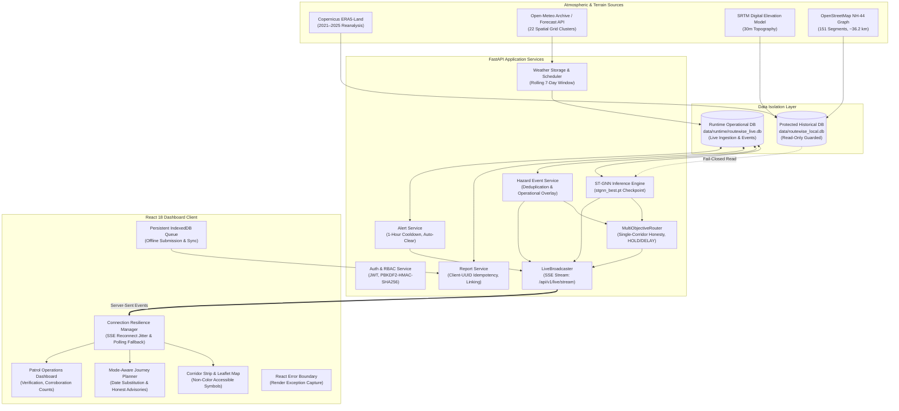

# RouteWise

**Predictive road-disruption risk intelligence for NH-44 (Ramban–Banihal), Jammu & Kashmir.**

RouteWise estimates landslide, snow and shooting-stone disruption risk for each road segment of a mountain highway corridor. It combines a graph model of the road network, ERA5-Land weather, SRTM terrain and historical disruption reports in a spatio-temporal graph neural network (ST-GNN), and serves predictions and operational overlays via a FastAPI backend to an accessible React dashboard. The system features real-time intelligence with three operational modes (`off`, `replay`, `live`), resilient Server-Sent Events (SSE) with automatic polling fallback, conservative incident report deduplication with additive linking, a patrol verification lifecycle, dynamic single-corridor journey planning with hold advisories, and English/Hindi localization. RouteWise is a minor project (Group 21, B.Tech Computer Science and Engineering, MIET Jammu, 2026).

> [!IMPORTANT]
> **Advisory only.** RouteWise outputs are relative-risk indices from a model trained on historical reanalysis and a small set of reported events. They are not calibrated physical failure probabilities, not live meteorological forecasts, and not a guarantee that a road is open or safe. Live atmospheric predictions represent an unvalidated distribution shift from training data and are explicitly badged *"Live data - Experimental - not validated"*. Always follow official Traffic Police and Traffic Control Unit (TCU) advisories.

> [!NOTE]
> **Verification status.** All backend API routes, role enforcement dependencies, journey planner calculations, persistent sync queues, real-time streaming connections, and deduplication logic in this document have been audited against the source code and verified with passing automated test suites:
> - **Backend Test Suite:** **206 passed** across all three operational modes (`ROUTEWISE_LIVE_MODE="off"`, `"replay"`, and `"live"`).
> - **Incident Deduplication Suite:** **34 passed** (`tests/test_incident_deduplication.py`).
> - **Historical Golden Tests:** **6 passed** (`tests/test_journey_golden.py`).
> - **Frontend Unit Suite:** **49 passed** across 14 suites (`npm --prefix frontend test`).
> - **Frontend Production Build:** **Succeeded** with Vite v6.4.4 (`npm --prefix frontend run build`).
> - **Protected Assets:** SHA-256 hashes of `stgnn_best.pt`, `data/routewise_local.db`, and `data/runtime/routewise_live.db` are strictly verified.

---

## Contents

1. [Project Overview and Problem Statement](#project-overview-and-problem-statement)
2. [Key Features](#key-features)
3. [Current Implementation Status](#current-implementation-status)
4. [System Architecture and Technology Stack](#system-architecture-and-technology-stack)
5. [Real-Time Intelligence & Operational Modes](#real-time-intelligence--operational-modes)
6. [Live Weather Ingestion & Data-Processing Pipeline](#live-weather-ingestion--data-processing-pipeline)
7. [Operational Hazard Events & Status Management](#operational-hazard-events--status-management)
8. [Incident Reporting & Conservative Deduplication](#incident-reporting--conservative-deduplication)
9. [Patrol Operations & Verification Lifecycle](#patrol-operations--verification-lifecycle)
10. [Live Dashboard, SSE Streaming & Resilience](#live-dashboard-sse-streaming--resilience)
11. [Journey Planning & Corridor Advisories](#journey-planning--corridor-advisories)
12. [Dashboard Features & Accessibility](#dashboard-features--accessibility)
13. [Roles and Access Control](#roles-and-access-control)
14. [Language Support](#language-support)
15. [API Documentation](#api-documentation)
16. [Data Sources and Preparation](#data-sources-and-preparation)
17. [ST-GNN Methodology and Results](#st-gnn-methodology-and-results)
18. [Installation and Setup](#installation-and-setup)
19. [Running the Backend and Frontend](#running-the-backend-and-frontend)
20. [Testing Instructions & Verified Evidence](#testing-instructions--verified-evidence)
21. [Repository Structure](#repository-structure)
22. [Limitations, Known Issues, and Safety Requirements](#limitations-known-issues-and-safety-requirements)
23. [Roadmap and Next Steps](#roadmap-and-next-steps)
24. [Acknowledgements and Data Attribution](#acknowledgements-and-data-attribution)

---

## Project Overview and Problem Statement

### The Problem
NH-44 (the Jammu–Srinagar National Highway) is the sole physical arterial surface link connecting the Kashmir Valley to the rest of India. The 36 km mountain section between **Ramban and Banihal** passes through the steep, geologically fragile Chenab gorge. This corridor is regularly closed by landslides, shooting stones, mudslides, and heavy winter snowfall. Travellers, commercial truckers, and emergency convoys have historically chosen departure times on distance alone, lacking structured forward-looking risk information. Existing public updates are mostly reactive, issued by Traffic Control Units (TCUs) and J&K Traffic Police only after a physical blockage has already stranded thousands of vehicles in hazardous terrain with minimal cellular coverage.

### The RouteWise Approach
RouteWise models the highway as an interconnected topological graph of **151 road segments**. It learns spatial and temporal disruption risk by combining 7-day rolling atmospheric sequences (Copernicus ERA5-Land reanalysis) with static terrain features (SRTM elevation and slope) in a Spatio-Temporal Graph Neural Network (ST-GNN). It then bridges predictive modeling with ground-level operational reality:
1. **Separation of Risk and Physical Overlay:** Retrospective ST-GNN risk models run alongside an operational hazard overlay (verified field reports, TCU notifications, operator simulations) without modifying underlying neural network weights.
2. **Real-Time Demonstration & Replay:** Ingests live numerical weather from Open-Meteo across 22 corridor clusters or replays historical storm sequences into an isolated runtime database (`data/runtime/routewise_live.db`).
3. **Single-Corridor Honesty:** The Chenab gorge has no parallel bypass routes. RouteWise strictly enforces `has_alternative=False`, issuing **`HOLD`** and **`DELAY`** advisories at prior staging depots rather than fabricating phantom detours.
4. **Field Incident Deduplication:** Field submissions are snapped to segments, normalized to preset hazard categories, and conservatively deduplicated within a 24-hour dual-timestamp window.
5. **Fail-Safe Integrity:** Any segment lacking complete 7-day weather or whose data exceeds 24 hours of staleness evaluates safely to `UNKNOWN` / `STALE_DATA` and is never defaulted to `Low` risk.

**Pilot corridor:** Ramban to Banihal (latitude 33.211°N to 33.475°N, longitude 75.161°E to 75.262°E), spanning 151 segments over ~36.2 km.

---

## Key Features

### Implemented and Verified with Automated Test Suites

- **GIS Corridor Graph & Terrain Engine:** 151 continuous road-segment edges with SRTM-derived elevation and slope gradient features (`nh44_corridor_graph.graphml`).
- **Spatio-Temporal Graph Neural Network (ST-GNN):** PyTorch implementation (2 GCNConv layers + GRU recurrent cell + linear projection), trained on 2021–2023 chronological splits, evaluated on held-out 2024–2025 test years (`stgnn_best.pt`).
- **Three Operational Real-Time Modes (`ROUTEWISE_LIVE_MODE=off|replay|live`):**
  - `off`: Default, pure historical reanalysis mode with 100% existing API and database parity.
  - `replay`: Replays historical storm sequences day-by-day from CSV into an isolated runtime database.
  - `live`: Periodically ingests live numerical weather from Open-Meteo across 22 spatial clusters, converts features to ERA5-equivalent units, rolls 7-day feature windows, and evaluates ST-GNN inference.
- **Strict Database & Runtime Isolation:** Protected historical database (`data/routewise_local.db`) is guarded against modification by fail-closed checks (`_is_protected_db()`). All runtime operations reside in `data/runtime/routewise_live.db`.
- **Deterministic Operational Status Overlay:** Synthesizes model risk with verified ground reports and TCU alerts into `OPEN`, `CAUTION`, `RESTRICTED`, `CLOSED`, or `UNKNOWN`.
- **Incident Intelligence & Conservative Deduplication (Task 4):**
  - Accepts 7 public report categories (`landslide`, `shooting_stones`, `flooding`, `road_damage`, `snow_or_ice`, `single_lane_or_obstruction`, `other`).
  - Normalizes non-preset categories to `road_damage` in accordance with `VALID_PRESETS`.
  - Additive schema linking (`duplicate_of`, `hazard_event_id`, `report_count`, `last_reported_at`).
  - Evaluates dual-timestamp 24-hour windows (`created_at` and `last_reported_at`).
  - Verified-only `last_reported_at` updates ensure unverified reports cannot extend hazard lifecycles.
  - Primary rejection closes active events; duplicate rejection unlinks duplicate reports.
- **Dynamic Single-Corridor Routing Engine:**
  - Evaluates physical transit duration alongside risk exposure.
  - Honest operational recommendations: **`HOLD`**, **`NO_DATA`**, **`DELAY`**, **`PROCEED_WITH_CAUTION`**, **`PROCEED`**.
  - Non-zero reason wording (never cites zero counts, e.g. "blocked by 1 closed segment (seg_050)", never "0 closed segments").
  - Live date substitution handling (`date_substituted=True`, `requested_date`, `actual_date`).
  - Enforces `has_alternative=False` on the single mountain highway corridor.
- **Live Connection Resilience & Polling Fallback:**
  - Server-Sent Events (`/api/v1/live/stream`) with 20-second heartbeats.
  - Client-side reconnection with full-jitter exponential backoff (capping at 30 seconds).
  - REST polling fallback (10s–30s interval) when streaming is interrupted.
- **Role-Based Access Control (RBAC):** Backend security dependencies strictly enforce role matrix (`guest`, `user`, `patrol`, `admin`) with PBKDF2-HMAC-SHA256 password hashing and signed JWT tokens.
- **Offline-Tolerant Browser Queue:** IndexedDB-backed pending report queue in the frontend with client-generated UUID idempotency and exponential backoff retry.
- **Accessible React Dashboard:** Interactive Leaflet corridor map, horizontal Ramban–Banihal strip, non-color geometric cues (`●`, `■`, `▲`, `?`, `~`), WCAG AA compliant theme tokens, and React ErrorBoundary.
- **English / Hindi Localization:** Complete bilingual interface (`en.json`, `hi.json`) with documented translation notes (`docs/TRANSLATION_REVIEW.md`).

### Planned Future Extensions (Not Yet Implemented)
- **Native Mobile Field App:** A native Flutter mobile client with SQLite offline storage (currently supported via offline browser queue).
- **Automated Computer-Vision Assessment:** Automated road-condition assessment from photos using Vision Transformers (ViT). Currently, attached photos serve exclusively as human evidence for patrol officers.
- **External Multi-Corridor Detour Networks:** Alternate regional highways (e.g. Mughal Road). Currently, routing is strictly restricted to the physical NH-44 alignment.
- **External Push / SMS Alerts:** RouteWise alerts are delivered exclusively within the web application interface; no cellular broadcast or SMS gateways are integrated.

---

## Current Implementation Status

| Component | Status | Verification Evidence & Test Coverage |
| :--- | :---: | :--- |
| **GIS Corridor Graph & Terrain** | Complete | `week1_graph_and_terrain.py`, 151 segments, SRTM elevation/slope |
| **Weather & Disruption Datasets** | Complete | `week2*` scripts, 274k weather rows, 99 snapped historical events |
| **ST-GNN Model Architecture & Weights** | Complete | Checkpoint `stgnn_best.pt` (SHA-256: `68B04504EAE6...5054006E`) |
| **Model Evaluation, Card & Calibration** | Complete | Held-out AP: 0.259 (best seed), 0.215 ± 0.041 (5-seed mean) |
| **FastAPI Backend Services** | Complete | **206 passed** in `off`, **206 passed** in `replay`, **206 passed** in `live` |
| **Incident Deduplication & Linking** | Complete | **34 passed** in `tests/test_incident_deduplication.py` |
| **Historical Golden Fixtures** | Complete | **6 passed** in `tests/test_journey_golden.py` |
| **React Web Dashboard** | Complete | **49 passed** in `npm --prefix frontend test`, Vite build succeeded |
| **Real-Time Modes (`off/replay/live`)** | Complete | Verified across runtime databases, Open-Meteo clustering, and replay |
| **Connection Resilience & Fallback** | Complete | Reconnect backoff with full jitter, REST polling fallback verified |
| **Dynamic Corridor Routing** | Complete | Single-corridor constraint, non-zero wording, date substitution verified |
| **Patrol Operations & Verification** | Complete | RBAC transitions, corroboration counts, audit trail history verified |
| **English / Hindi Localization** | Complete | 100% key parity across `en.json` and `hi.json`, unreviewed keys logged |
| **Native Flutter Field App** | Planned | Offline browser queue implemented; native mobile client planned |
| **Automated ViT Photo Classification** | Planned | Manual photo evidence review only; automated CV not implemented |

---

## System Architecture and Technology Stack



### Technology Matrix
- **Data Engineering & GIS:** Python 3.11, OSMnx, NetworkX, pandas, rasterio, cdsapi, netCDF4, geopandas.
- **Neural Network Modeling:** PyTorch 2.x (2-layer GCNConv + GRU recurrent cell), scikit-learn baselines.
- **Backend Infrastructure:** FastAPI, Uvicorn ASGI server, Pydantic v2 schemas, SQLite3, Pillow (EXIF metadata stripping).
- **Frontend Architecture:** React 18, Vite, React-Leaflet v4, Lucide React icons, Vanilla CSS semantic design tokens.
- **Client Offline Storage:** Browser IndexedDB (Dexie-compatible schema for pending sync queue).
- **Internationalization:** Custom i18n JSON provider supporting English (`en.json`) and Hindi (`hi.json`).

---

## Real-Time Intelligence & Operational Modes

RouteWise is configured at startup using the `ROUTEWISE_LIVE_MODE` environment variable:

```text
ROUTEWISE_LIVE_MODE = "off" | "replay" | "live"
```

### 1. `ROUTEWISE_LIVE_MODE=off` (Historical Baseline Mode - Default)
- **Behavior:** Background schedulers, external fetchers, and live polling daemons remain completely inactive.
- **Data Source:** Serves strictly historical reanalysis data from `cache/precomputed_risk_cache.json` and `data/weather_daily_by_segment.csv` (1,821 dates: 2021 to 2025).
- **Parity:** Guarantees 100% backward compatibility with all historical baseline tests and golden fixtures. Any attempt by clients to call live-only simulation endpoints returns `HTTP 409 Conflict`.

### 2. `ROUTEWISE_LIVE_MODE=replay` (Demonstration Replay Mode)
- **Behavior:** Replays historical weather observations day-by-day from `data/weather_daily_by_segment.csv` as if they were arriving live, storing them into the isolated runtime database `data/runtime/routewise_live.db`.
- **Purpose:** Enables evaluators, educators, and automated CI pipelines to test the complete end-to-end real-time pipeline, SSE streaming, in-app alerts, dynamic route recalculation, and scenario progression with zero external network dependencies.
- **UI Tag:** Displays persistent badge: **`REPLAY / simulated scenario`**.

### 3. `ROUTEWISE_LIVE_MODE=live` (Live Operational Mode)
- **Behavior:** Periodically polls numerical weather observations from the Open-Meteo REST API (free tier, no API key required) on a configurable schedule (`LIVE_WEATHER_INTERVAL_MINUTES=60`).
- **Processing:** Ingests atmospheric metrics across 22 spatial clusters, converts snowfall to ERA5 water-equivalent units, constructs rolling 7-day feature windows, evaluates ST-GNN inference on the fly, and updates derived operational statuses.
- **UI Tag:** Displays prominent amber badge: **`Live data - Experimental - not validated`**.

### Runtime Database Isolation
To ensure absolute integrity of historical research data:
- `data/routewise_local.db` is strictly protected and read-only.
- All live weather observations, live risk evaluations, active hazard events, audit logs, and in-app alerts are written strictly to `data/runtime/routewise_live.db` (git-ignored).
- Simulated demo events (`is_simulated = 1`) reside solely in the runtime database and are permanently excluded from historical training datasets.

---

## Live Weather Ingestion & Data-Processing Pipeline

```text
Open-Meteo REST API  ──(22 Centroids)──>  Spatial Fan-Out (151 Segments)
                                                  │
                                                  ▼
                                      Unit Conversion (10:1 Snow Density)
                                                  │
                                                  ▼
                                     Rolling 7-Day Window Construction
                                     (weather_window_end = yesterday_utc)
                                                  │
                                                  ▼
                                      Fail-Safe Freshness Audit
                                  (Age > 24h OR Incomplete -> UNKNOWN)
                                                  │
                                                  ▼
                                        PyTorch ST-GNN Inference
                                        (stgnn_best.pt Checkpoint)
                                                  │
                                                  ▼
                                      live_risk Database Storage
```

### 1. Spatial Clustering
ERA5-Land reanalysis has a native grid resolution of ~9 km (~0.1°). The 151 segments spanning the 36 km corridor are grouped into **22 spatial grid centroids** using Euclidean nearest-neighbor clustering (`src/services/weather/clustering.py`). During live weather ingestion, requests are dispatched once per centroid and fanned out across member segments, reducing external HTTP network calls by 85%.

### 2. Feature Conversion & Rolling 7-Day Window
The ST-GNN model requires 7 contiguous dynamic meteorological features:
- `precip_mm`: Daily total precipitation (mm).
- `snowfall_mm_we`: Daily snowfall converted to mm water-equivalent assuming an idealized 10:1 snow-to-water density ratio (`1 cm snow = 1.0 mm_we`).
- `temp_mean_c`: Mean 2-meter air temperature (°C).
- `temp_min_c`: Minimum 2-meter air temperature (°C).
- `snow_depth_m`: Surface snow depth (m).
- `precip_3d_mm`: 3-day cumulative precipitation (mm).
- `precip_7d_mm`: 7-day cumulative precipitation (mm).

### 3. Strict UTC Window Semantics
Because the model was trained on calendar days aggregated across UTC midnight (`00:00:00Z to 23:59:59Z`), live inference queries strictly complete historical days:
$$\text{weather\_window\_end} = \text{yesterday}_{\text{UTC}}$$
Live predictions publish relative risk for the forward target date ($\text{as\_of} = \text{today}_{\text{UTC}}$).

### 4. Distribution Shift Limitations
ECMWF ERA5-Land reanalysis is a retrospective model assimilation, whereas Open-Meteo provides numerical forecast and station-blended measurements. Topographic elevation downscaling in the Pir Panjal range introduces localized precipitation intensity differences. Consequently, RouteWise explicitly discloses that live numerical weather represents an **unvalidated distribution shift**, ensuring users treat scores as situational indices rather than calibrated physical guarantees.

---

## Operational Hazard Events & Status Management

Active hazard events (field reports, operator simulations, official TCU advisories) act as an **operational overlay**. They **never modify model weights, model input tensors, or calculated ST-GNN risk scores**. The API returns both `model_risk` and `active_events[]`, synthesizing them into a derived `operational_status`.

### Deterministic Operational Status Rule Table

| Priority | Evaluated Condition | Resulting `operational_status` | Operational Meaning |
|:---:|---|:---:|---|
| **1** | Any active event with `severity == 'critical'` OR `hazard_type in ('landslide', 'flooding')` | **`CLOSED`** | Road physically blocked or impassable. Traffic must hold. |
| **2** | Any active event with `hazard_type in ('single_lane', 'single-lane')` OR `severity == 'high'` OR (`hazard_type in ('shooting_stones', 'snow_ice', 'road_damage')` AND `severity == 'medium'`) | **`RESTRICTED`** | Reduced capacity, convoys, or severe slowdown. Proceed with caution. |
| **3** | Model input is missing (< 7 days) or stale (> 24h) AND no critical/blocking physical event | **`UNKNOWN`** | Telemetry deficit: advisory status cannot be safely determined. Never defaults to Low/Open. |
| **4** | Active event with `severity in ('low', 'medium')` OR `model_risk.risk_tier in ('Medium', 'High')` | **`CAUTION`** | Elevated hazard potential or minor localized disturbance. |
| **5** | `model_risk.risk_tier == 'Low'` AND zero active events on the segment | **`OPEN`** | Normal operational flow under standard advisory guidelines. |

---

## Incident Reporting & Conservative Deduplication

RouteWise provides an incident reporting and deduplication engine (Task 4) designed to handle crowd-sourced observations while preventing duplicate hazard clutter on the corridor.

### 1. Supported Report Categories & Normalization
The API accepts 7 distinct `ReportCategory` values:
- `landslide`: Maps to preset `landslide` (Severity: critical, Duration: 24h).
- `shooting_stones`: Maps to preset `shooting_stones` (Severity: high, Duration: 12h).
- `flooding`: Maps to preset `flooding` (Severity: critical, Duration: 12h).
- `road_damage`: Maps to preset `road_damage` (Severity: medium, Duration: 48h).
- `snow_or_ice`: Falls back to `road_damage` in accordance with `VALID_PRESETS`.
- `single_lane_or_obstruction`: Falls back to `road_damage` in accordance with `VALID_PRESETS`.
- `other`: Falls back to `road_damage` in accordance with `VALID_PRESETS`.

**Preset Separation:** Reports submitted with different preset categories on the same segment create independent hazard events. Reports submitted with fallback categories merge into existing active road-damage events as corroborating duplicates.

### 2. Dual-Timestamp Deduplication Window (24.0 Hours)
When a report is submitted, RouteWise evaluates active hazard events on the snapped segment matching the normalized hazard type and simulation mode:
```sql
WHERE segment_id = :segment_id
  AND hazard_type = :hazard_type
  AND COALESCE(is_simulated, 0) = :is_simulated
  AND status = 'active'
  AND expires_at > :now
  AND (created_at >= :dedup_limit OR (last_reported_at IS NOT NULL AND last_reported_at >= :dedup_limit))
ORDER BY created_at ASC
LIMIT 1
```
If an active event exists within this window, the incoming report is linked as a duplicate:
- `reports.duplicate_of = primary_report.id`
- `reports.hazard_event_id = active_event.id`
- `hazard_event.report_count = report_count + 1`

### 3. Verified-Only Window Extension
To prevent malicious or spam submissions from artificially keeping a hazard open indefinitely, **`last_reported_at` updates and extends the deduplication window only when a corroborating report is marked `verified` by an authorized patrol officer or administrator**. Unverified submissions do not extend the active lifecycle.

### 4. Primary vs. Duplicate Rejection Semantics
- **Rejecting the Primary Report:** Immediately transitions the active hazard event to `closed`. Any duplicate reports that were linked remain preserved in `reports` for audit history.
- **Rejecting a Duplicate Report:** Sets `duplicate_of = NULL` on that report, leaving the active hazard event open.

### 5. Fail-Closed Protected Database Guard
`src/services/report_service.py` enforces a fail-closed write guard (`_is_protected_db(path)`) that treats any unresolved or historical database path as protected, ensuring that tests and operational services cannot alter `data/routewise_local.db`.

---

## Patrol Operations & Verification Lifecycle

Field observations follow a strict state-machine lifecycle enforced in `src/services/report_service.py`:

```text
[submitted] ──(Patrol Verifies)──> [verified] ──(Unit Assigned)──> [assigned] ──(Cleared)──> [resolved]
     │                                  │
     └──────────(Spurious / Duplicate)──┴──────(Patrol Rejects with Note)───────────────> [rejected]
```

### Audit Trail & Independent Reporter Tracking
- Every transition appends an immutable entry to `report_status_history` logging `actor_id`, `actor_role`, `from_status`, `to_status`, `timestamp`, and mandatory rejection `note`.
- When corroborating reports are linked to an active hazard, the system tracks reporter independence: repeated submissions by the same user do not inflate independent reporter counts.

---

## Live Dashboard, SSE Streaming & Resilience

The React dashboard maintains a resilient real-time connection to the backend via Server-Sent Events (SSE):

### Connection States (`connectionResilience.js`)
- **`connected`:** Receiving active SSE events and 20-second heartbeats.
- **`reconnecting`:** Stream interrupted; reconnects using exponential backoff with full random jitter (base 1s, factor 2, capped at 30 seconds).
- **`polling`:** When disconnected or in degraded environments, falls back to REST polling every 10–30 seconds.
- **`offline`:** Browser network offline.

### Top-Level Error Boundary
`frontend/src/components/ErrorBoundary.jsx` wraps the React component tree. If an uncaught rendering error occurs, it traps the exception, logs component stack traces, and renders a localized bilingual fallback with an application reload button.

---

## Journey Planning & Corridor Advisories

The RouteWise Journey Planner evaluates transit feasibility along the 151 segments of NH-44:

### 1. Single-Corridor Honesty Constraint
The NH-44 Ramban–Banihal highway traverses a narrow mountain gorge with no parallel bypasses. RouteWise strictly enforces `has_alternative=False`. The router will never invent synthetic detour roads.

### 2. Operational Recommendations & Reason Formatting
Routing recommendations dynamically evaluate physical status and hazard risk:
- **`HOLD`:** One or more segments on the route are physically `CLOSED`. Advises holding at the nearest staging depot (e.g. *"Corridor is blocked by 1 closed segment (seg_050) due to active hazard. Hold at nearest staging yard."*). Never cites zero counts.
- **`NO_DATA`:** Route includes unmonitored segments or live telemetry is stale (>24h).
- **`DELAY`:** High disruption hazard tier ($\ge 0.35$) detected along the corridor.
- **`PROCEED_WITH_CAUTION`:** Elevated hazard score ($0.10 - 0.35$) on segments.
- **`PROCEED`:** All corridor segments clear and baseline risk is low ($< 0.10$).

### 3. Live Date Substitution Notice
When querying a journey plan in live mode for a requested date lacking live telemetry, the service evaluates the route using the latest live date and returns:
- `date_substituted: true`
- `requested_date: "2023-07-09"`
- `actual_date: "2026-11-10"`

The frontend presents a prominent translated notice explaining the substitution.

---

## Dashboard Features & Accessibility

| Feature | Description |
| :--- | :--- |
| **Corridor Strip** | Horizontal 151-segment strip with chainage landmarks from Dewal (Km 0) to Banihal (Km 36). |
| **Interactive Map** | Leaflet / React-Leaflet map with toggleable layers: Risk, Field Reports, Weather, Services. |
| **Non-Color Accessibility Cues** | Geometric symbols ensure accessibility for color-blind users: `●` Low, `■` Medium, `▲` High, `?` Unknown, `~` Stale. |
| **WCAG AA Contrast Tokens** | High-contrast semantic CSS tokens in `frontend/src/theme.css` verified for WCAG AA compliance (≥ 4.5:1 text contrast). |
| **Segment Inspector** | Detailed slide-out drawer presenting genuine physical input features (elevation, slope, precipitation). |
| **Scenario Player** | Steppable demonstration player simulating the accelerated 5-phase July 2023 monsoon storm sequence. |
| **Alert Drawer** | In-app notification drawer for active corridor disruption alerts with patrol acknowledgement. |

---

## Roles and Access Control

| Role | How Obtained | Access Permissions |
| :--- | :--- | :--- |
| **Guest** | "Continue as Guest" on landing page | Read-only access to corridor map, risk strips, journey planner, and alerts. Cannot submit reports. |
| **User** | Public registration (`/auth/register`) | Guest access plus submitting field reports with photos and viewing personal submission history. |
| **Patrol** | Provisioned via CLI (`create_patrol`) | User access plus Patrol Operations dashboard: verifying, assigning, and resolving field reports. |
| **Admin** | Provisioned via database bootstrap / promote | Patrol access plus user role management and triggering/clearing simulated hazard events. |

- Passwords are encrypted using PBKDF2-HMAC-SHA256 (100,000 iterations, 16-byte random salt).
- Sessions authenticate via signed HS256 JWT tokens.

---

## Language Support

The dashboard provides bilingual localization across English and Hindi (`en.json`, `hi.json`):
- Translation preferences persist across sessions.
- In accordance with safety disclosures, Hindi translations are machine-assisted domain localizations that have not yet been certified by a native-speaking transport linguist (`docs/TRANSLATION_REVIEW.md`).
- All alerts and advisories are delivered strictly in-app.

---

## API Documentation

FastAPI automatically generates interactive OpenAPI documentation when the backend is running:
- **Interactive Swagger UI:** <http://127.0.0.1:8000/docs>
- **OpenAPI JSON Schema:** <http://127.0.0.1:8000/openapi.json>

### Core Endpoint Catalog

| Group | Method & Path | Required Role | Description |
| :--- | :--- | :---: | :--- |
| **System** | `GET /api/health` | None | Health check, model version, checkpoint hash |
| **Auth** | `POST /api/v1/auth/register` | None | Register new commuter (`user` role strictly forced) |
| | `POST /api/v1/auth/login` | None | Sign in, receive signed JWT access token |
| | `POST /api/v1/auth/guest` | None | Issue read-only guest session token |
| | `GET /api/v1/auth/me` | User | Retrieve current user profile |
| **Risk** | `GET /api/v1/risk` | None | Retrospective segment risk scores for observation date |
| | `GET /api/v1/risk/dates` | None | Catalog of 1,821 historical observation dates (2021–2025) |
| **Corridor** | `GET /api/v1/corridor/segments` | None | 151 segment GeoJSON geometries & metadata |
| | `GET /api/v1/corridor/segments/{id}/features` | None | Static terrain & environmental features |
| | `GET /api/v1/corridor/services` | None | Along-route medical, fuel, and recovery facilities |
| **Journey** | `GET /api/v1/journey/places` | None | Landmarks and towns along NH-44 |
| | `POST /api/v1/journey/plan` | None | Physical chainage routing with risk & hold advisories |
| **Live** | `GET /api/v1/live/status` | None | Current live telemetry status, provider, weather window |
| | `GET /api/v1/live/risk` | None | Current live risk scores & operational statuses |
| | `GET /api/v1/live/stream` | None | Server-Sent Events real-time broadcast stream |
| **Events** | `GET /api/v1/events/active` | None | Active public hazard events overlay |
| | `POST /api/v1/events/simulate` | Admin | Trigger simulated hazard event on a segment |
| | `POST /api/v1/events/simulate/clear` | Admin | Purge all simulated hazard events |
| **Reports** | `POST /api/v1/reports` | User | Submit field report (client-UUID idempotent, deduplicated) |
| | `GET /api/v1/reports` | Patrol | List all submitted reports for patrol review |
| | `GET /api/v1/reports/mine` | User | List reports submitted by authenticated user |
| | `PATCH /api/v1/reports/{id}/status` | Patrol | Transition report state machine (`verified`, `resolved`, `rejected`) |
| | `GET /api/v1/reports/{id}/photo` | User | Secure retrieval of attached photo evidence |
| **Alerts** | `GET /api/v1/alerts/active` | None | Active corridor disruption alerts |
| | `POST /api/v1/alerts/{id}/acknowledge` | Patrol | Acknowledge active alert |
| | `POST /api/v1/alerts/{id}/clear` | Patrol | Clear active alert |
| | `POST /api/v1/alerts/scenario/step` | Admin | Step July 2023 monsoon demonstration scenario |

---

## Data Sources and Preparation

| Dataset | Source | Spatial / Temporal Resolution | Usage |
| :--- | :--- | :--- | :--- |
| **Road Network** | OpenStreetMap via OSMnx | 151 segment edges, 76 junction nodes | Topological corridor graph |
| **Elevation & Slope** | USGS SRTM via OpenTopography | ~30m raster grid | Static terrain slope and elevation features |
| **Atmospheric Weather** | Copernicus ERA5-Land Reanalysis | ~9 km grid, daily (2021–2025) | Dynamic precipitation and temperature inputs |
| **Historical Disruptions** | Regional news archives (Greater Kashmir, Tribune) | 99 verified physical road closures | Ground-truth training and validation labels |

Every historical event in `data/disruption_candidates.csv` has a verifiable news source link; zero simulated events exist in historical training tables (`data/training_samples.csv` has `is_simulated = 0` for all 1,981 records).

---

## ST-GNN Methodology and Results

- **Model Architecture:** 2 graph convolution layers (mixing features across 966 directed segment adjacency connections) + GRU recurrent cell (reading 7 daily sequential feature vectors) + linear projection combining temporal representation with 4 static terrain features.
- **Chronological Split:** Train (pre-2023, 855 samples, 28 events), Validation (2023, 434 samples, 14 events), Held-out Test (2024–2025, 680 samples, 22 events).
- **Test Set Performance (Held-out 2024–2025):**
  - Base Rate (Random Guessing): 0.032 AP
  - Rainfall-Only Logistic Regression: 0.105 AP
  - All-Features Logistic Regression: 0.174 AP
  - **ST-GNN (5-Seed Mean):** **0.215 ± 0.041 AP**
  - **ST-GNN (`stgnn_best.pt` Best Seed):** **0.259 AP**
- **Thresholds on Held-out Events (22 Real Events):**
  - Medium Tier ($\ge 0.10$): Caught 18/22 events (81.8% recall), 249 false alarms.
  - High Tier ($\ge 0.35$): Caught 13/22 events (59.1% recall), 90 false alarms.
- **Inference Latency:** Local CPU inference evaluates all 151 segments in median 67.6 ms (P95: 137.3 ms).

---

## Installation and Setup

### Prerequisites
- Windows 10/11 with PowerShell (or Linux / macOS)
- Python 3.11
- Node.js 18+ and npm

### 1. Python Virtual Environment
From project root:
```powershell
python -m venv venv
.\venv\Scripts\Activate.ps1
python -m pip install --upgrade pip
python -m pip install -r requirements.txt
```

### 2. Database Bootstrap
Initialize the SQLite database schema and populate historical segment weather data:
```powershell
python -m app.bootstrap_db
```
Populates 274,971 historical segment weather rows idempotently into `data/routewise_local.db`.

### 3. Environment Configuration
Copy `.env.example` to `.env` and configure settings:
```powershell
cp .env.example .env
```
Key configuration parameters:
- `ROUTEWISE_LIVE_MODE`: Operational mode (`off`, `replay`, `live`).
- `ROUTEWISE_SECRET_KEY`: Minimum 32-character secret key for JWT signing.
- `ROUTEWISE_LIVE_DB_PATH`: Runtime operational database path (`data/runtime/routewise_live.db`).
- `DEMO_PATROL_PASSWORD`, `DEMO_USER_PASSWORD`: Passwords for seeded demo accounts.

---

## Running the Backend and Frontend

Run the services in two separate terminal sessions:

### Terminal 1: Backend API
```powershell
.\venv\Scripts\Activate.ps1
python -m uvicorn src.api.app:app --host 127.0.0.1 --port 8000 --reload
```
- API Docs: <http://127.0.0.1:8000/docs>
- Health Check: <http://127.0.0.1:8000/api/health>

### Terminal 2: Frontend Dashboard
```powershell
cd frontend
npm install
npm run dev
```
Dashboard opens at: <http://localhost:5173>

### Provisioning Accounts & Demonstration Data
1. **Interactive Patrol Creation:**
   ```powershell
   python -m app.create_patrol --email officer@routewise.ai --name "Officer Singh"
   ```
   Prompts securely for password using `getpass.getpass` (never printed to terminal).
2. **Seed Simulated Demonstration Incidents:**
   ```powershell
   python -m app.seed_demo
   ```
   Creates `patrol@routewise.ai` and `demo@routewise.ai` (flagged `is_simulated = 1`) and seeds 5 sample corridor reports.
3. **Purge Simulated Data:**
   ```powershell
   python -m app.seed_demo --clear
   ```
   Wipes all simulated reports and demo accounts instantly.

---

## Testing Instructions & Verified Evidence

### 1. Full Backend Test Suite (All 3 Operational Modes)
Run the complete backend suite across each supported mode:
```powershell
# Off mode (pure historical parity)
$env:ROUTEWISE_LIVE_MODE="off"; .\venv\Scripts\python.exe -m pytest -q
# Result: 206 passed, 4 warnings in 93.53s

# Replay mode (isolated storm playback)
$env:ROUTEWISE_LIVE_MODE="replay"; .\venv\Scripts\python.exe -m pytest -q
# Result: 206 passed, 4 warnings in 74.23s

# Live mode (Open-Meteo clustering ingestion)
$env:ROUTEWISE_LIVE_MODE="live"; .\venv\Scripts\python.exe -m pytest -q
# Result: 206 passed, 4 warnings in 73.38s
```

### 2. Incident Deduplication Backend Suite
```powershell
.\venv\Scripts\python.exe -m pytest tests/test_incident_deduplication.py -q
# Result: 34 passed, 1 warning in 12.38s
```

### 3. Historical Golden Tests
```powershell
.\venv\Scripts\python.exe -m pytest tests/test_journey_golden.py -q
# Result: 6 passed in 2.73s
```

### 4. Frontend Unit Tests
```powershell
npm --prefix frontend test
# Result: 49 passed, 0 failed across 14 suites in 1.99s
```

### 5. Frontend Production Build
```powershell
npm --prefix frontend run build
# Result: Vite v6.4.4 build succeeded in 6.35s
```

### 6. Repository Hygiene & Protected Hash Audit
```powershell
git diff --check
Get-FileHash data/routewise_local.db
# SHA-256: 917A1C475E2FF2D8D9E877F9321BEDF1D99F1877D446EE4667D86FA3E3D96BC6
```

### Automated Testing vs. Manual Browser Verification
- **Automated Verification:** All API endpoints, state machines, math models, routing calculations, SSE connection resilience backoff, and i18n translation parity are fully verified by automated tests.
- **Manual Verification:** Full multi-step browser demonstrations (such as interacting with the Leaflet map layers, switching themes, or reviewing physical photos) have been walked through in local sessions and remain documented in [`docs/DEMO_SCRIPT.md`](docs/DEMO_SCRIPT.md).

---

## Repository Structure

```text
RouteWise/
├── README.md                          # Primary system documentation
├── requirements.txt                  # Python application runtime dependencies
├── requirements-pipeline.txt         # Offline GIS and atmospheric pipeline dependencies
├── .env.example                      # Configuration template (secrets never committed)
├── .gitignore                        # Enforces exclusion of .env, databases, caches, uploads
├── data/                             # Ground-truth datasets and models
│   ├── routewise_local.db            # Protected historical SQLite database (read-only guarded)
│   ├── segment_static.csv            # 151 segments static elevation, slope, length
│   ├── segment_adjacency.csv         # 966 directed segment graph connections
│   ├── weather_daily_by_segment.csv  # 2021-2025 daily ERA5-Land reanalysis
│   ├── disruption_candidates.csv     # Verified historical disruption news records
│   ├── runtime/                      # Isolated runtime storage (git-ignored)
│   │   └── routewise_live.db         # Runtime database for live weather, risk & alerts
│   └── weather/                      # Raw ERA5-Land NetCDF archives (2021-2025)
├── cache/                            # Precomputed risk cache (1,821 dates) & geocoding
├── docs/                             # Technical documentation
│   ├── ARCHITECTURE_NOTES.md         # Deep-dive architecture and component notes
│   ├── DEMO_SCRIPT.md                # 5-7 minute operational evaluation walkthrough
│   ├── REALTIME_PROGRESS.md          # Real-time intelligence task tracking log
│   ├── LIVE_DATE_SEMANTICS.md        # Strict UTC alignment & 24h staleness rules
│   ├── LIVE_WEATHER_VALIDATION.md    # Atmospheric distribution shift evaluation
│   ├── PERFORMANCE_NOTES.md          # Journey planner latency & query optimizations
│   ├── TRANSLATION_REVIEW.md         # English/Hindi localization notes and unreviewed keys
│   └── model_card.md                 # ST-GNN evaluation, calibration, and latency benchmarks
├── app/                              # Database and operations CLI utilities
│   ├── bootstrap_db.py               # Idempotent SQLite schema setup
│   ├── create_patrol.py              # Secure interactive CLI for provisioning patrol officers
│   └── seed_demo.py                  # Seeds/clears simulated demo accounts and reports
├── src/
│   ├── api/                          # FastAPI app, config, dependencies, routes, and schemas
│   │   ├── routes/                   # auth, corridor, disruptions, events, journey, live, reports, alerts
│   │   └── schemas/                  # Pydantic request and response schemas
│   ├── models/                       # ST-GNN inference and calibration wrappers
│   └── services/                     # Business logic
│       ├── weather/                  # Open-Meteo clustering, scheduler, replay provider, storage
│       ├── alert_service.py          # Alert lifecycle, 1-hour cooldown, auto-clearance
│       ├── hazard_event_service.py   # Hazard overlays, operational status rule table
│       ├── journey_service.py        # Corridor journey planning & date substitution
│       ├── live_risk_service.py      # Live ST-GNN rolling window inference wrapping
│       ├── report_service.py         # Incident deduplication, linking, photo stripping, DB guard
│       └── routing_engine.py         # Multi-objective Dijkstra routing engine
├── frontend/                         # React dashboard (Vite, Leaflet, i18n, Vanilla CSS)
│   ├── package.json
│   ├── vite.config.js
│   ├── test/unit.test.js             # 49 frontend unit tests (14 test suites)
│   └── src/
│       ├── components/               # CorridorStrip, CorridorMap, JourneyPlanner, AlertDrawer, Inspector
│       ├── i18n/locales/             # en.json and hi.json translation catalogs
│       ├── services/                 # incidentHelper.js, connectionResilience.js, reportQueue.js
│       └── theme.css                 # WCAG AA compliant semantic theme tokens
├── tests/                            # Automated test suite (206 backend tests)
│   ├── test_incident_deduplication.py# 34 incident deduplication & schema tests
│   ├── test_journey_golden.py        # 6 historical golden plan fixture tests
│   ├── test_simulation_isolation.py  # Simulation isolation tests
│   └── test_*.py                     # Auth, corridor, alerts, weather, routing, calibration tests
├── stgnn_best.pt                     # Best trained ST-GNN PyTorch checkpoint
├── stgnn_metrics.json                # Final model evaluation metrics across 5 seeds
└── week*.py                          # GIS, weather, dataset, ST-GNN training scripts
```

---

## Limitations, Known Issues, and Safety Requirements

### Scope Limitations
- **Advisory Relative Risk:** ST-GNN scores represent an advisory relative-risk index (0.0 to 1.0), not calibrated physical failure probabilities.
- **Single Physical Corridor:** The NH-44 Ramban–Banihal highway is a single road alignment through the Chenab gorge. No parallel highway alternatives exist within this corridor road graph; RouteWise enforces `has_alternative=False` and will never fabricate phantom bypass detours.
- **Unvalidated Distribution Shift:** Live numerical forecasts from Open-Meteo diverge from the Copernicus ERA5-Land reanalysis used to train the model. All live outputs are explicitly designated as experimental.
- **In-App Delivery Boundary:** Disruption alerts and advisories are delivered exclusively within the web application interface. No external SMS gateways, mobile push notifications, or cellular broadcast mechanisms are claimed or used.
- **Evidence Review Only:** Photos attached to field incident reports serve strictly as human evidence for patrol review. Automated computer-vision classification (ViT) is not implemented.
- **Browser-Only Offline Queue:** The frontend provides an offline-tolerant IndexedDB report queue in the browser. A native mobile client (Flutter) is not implemented.

### Model Limitations
- **Rare Event Sample Size:** Real highway closures are rare (only 22 independent events in the 2024–2025 held-out test years). Differences between model seeds are subject to high variance.
- **False Alarm Trade-off:** At the High-risk threshold ($\ge 0.35$), the model misses 9 of 22 test events and produces 90 false alarms. At the Medium threshold ($\ge 0.10$), it catches 18 of 22 events but produces 249 false alarms.
- **Sudden Events:** Dry rockfall and sudden cloudbursts without antecedent rainfall cannot be predicted from daily meteorological aggregations alone.

---

## Roadmap and Next Steps

The full 16-week project implementation specification is recorded in [`docs/development-plan.md`](docs/development-plan.md):

1. **Native Field Mobile Client:** Develop a native Flutter mobile application utilizing the existing SQLite offline schema for remote patrol officers with intermittent cellular reception.
2. **Multi-Corridor Regional Graph:** Ingest and digitize alternate regional mountain highway alignments (e.g. Mughal Road via Shopian) to enable genuine multi-corridor regional detour evaluation.
3. **Automated Vision Pipeline:** Train and integrate a Vision Transformer (ViT) to assist patrol officers with automated preliminary classification of attached road-damage and rockfall imagery.
4. **Professional Linguistic Review:** Conduct native-speaker linguistic audit and certification of the Hindi localized interface (`hi.json`) in collaboration with regional transport safety authorities.

---

## Acknowledgements and Data Attribution

- **Road Network & Map Basemap:** © OpenStreetMap contributors, accessed via OSMnx under the Open Database Licence.
- **Digital Elevation Model:** NASA / USGS Shuttle Radar Topography Mission (SRTM), accessed via OpenTopography.
- **Atmospheric Reanalysis:** ECMWF ERA5-Land reanalysis, generated using Copernicus Climate Change Service information. Neither the European Commission nor ECMWF is responsible for any use that may be made of the Copernicus information.
- **Live Weather Ingestion:** Open-Meteo Free Weather API (CC BY 4.0).
- **Disruption Incident Sourcing:** Regional reporting from *Greater Kashmir*, *The Tribune*, *Kashmir Life*, *Deccan Herald*, *ETV Bharat*, and J&K Traffic Police announcements.
- **Academic Framework:** Minor Project Group 21, Department of Computer Science & Engineering, Model Institute of Engineering and Technology (MIET), Jammu, 2026.
